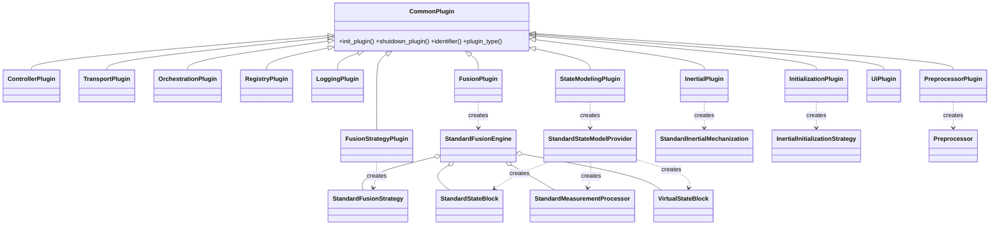
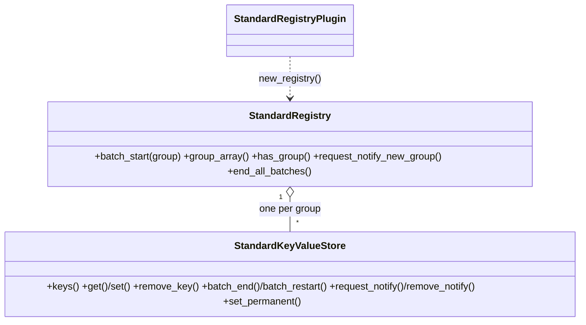
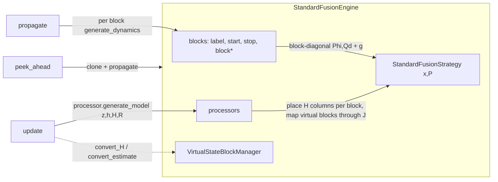
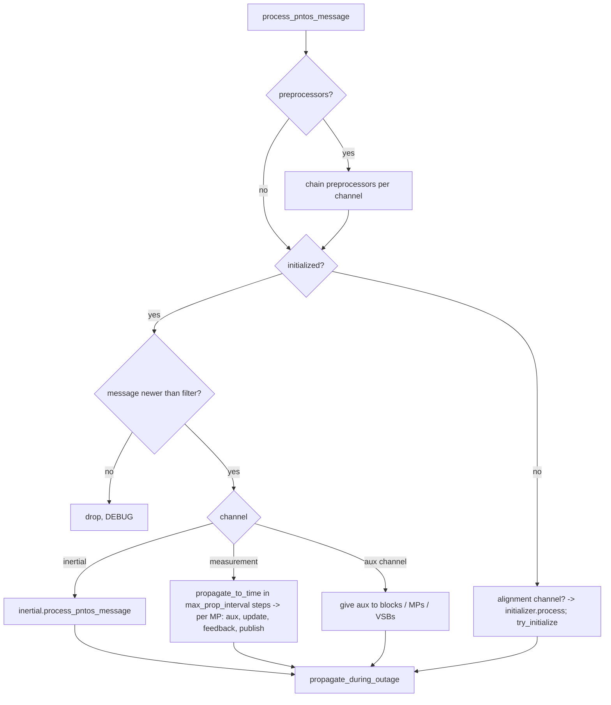

# pntos-cpp design guide

This is the working design document for the C++ rewrite of Cobra. It is written so that someone who
has the repository, the Python original (the `Cobra/` submodule) and a C++20 toolchain can continue
the port without any other context. Read it together with:

- `docs/COBRA_ANALYSIS.md` — what the Python original does, its baselines, its quirks (§12) and the
  original port plan (§13). This document supersedes §13 where they differ.
- `docs/TESTING.md` — how the test suite is organised, how to port a Python test, how acceptance is
  measured.
- `docs/PROGRESS.md` — the dated log of what was done and why.

Sections:

1. [Scope and principles](#1-scope-and-principles)
2. [Build system](#2-build-system)
3. [Repository layout and namespaces](#3-repository-layout-and-namespaces)
4. [Type and idiom mapping Python → C++](#4-type-and-idiom-mapping-python--c)
5. [The API layer](#5-the-api-layer)
6. [Conventions: errors, logging, ownership, threads](#6-conventions-errors-logging-ownership-threads)
7. [Component designs](#7-component-designs)
8. [Deviations from the Python original](#8-deviations-from-the-python-original)
9. [Roadmap: what remains and how to do it](#9-roadmap-what-remains-and-how-to-do-it)
10. [Recipes](#10-recipes)
11. [Coding conventions](#11-coding-conventions)

---

## 1. Scope and principles

The goal is a C++ implementation of the pntOS plugin architecture that is **behaviourally identical to
Cobra** (same registry layout, same config semantics, same filter mathematics, same message routing),
proved by porting Cobra's own test suite and then by reproducing its application-level results on the
example log (`COBRA_ANALYSIS.md` §2 and §14).

Principles that were applied throughout and should be kept:

1. **One Python class, one C++ class, same name, same method names.** Someone reading the Python can
   find the C++ immediately. `snake_case` methods are kept as in Python; the pntOS-C API names are the
   same anyway.
2. **Same registry layout.** Configs written by the C++ `to_registry` produce exactly the groups and
   keys the Python `config_to_registry` produces (nested configs as `_<field>_groups` pointers,
   EstimateWithCovariance as `_estimate` / `_covariance` / `_ewc_type`, enums as integers, 3-vectors
   as matrices). A Python-written permanency file and a C++-written one are interchangeable for every
   type except `Message` (Python pickles it; see §8).
3. **Fix a Python bug only when it is a bug, and record it.** Two latent bugs were found and fixed in
   the port (`COBRA_ANALYSIS.md` §12 items 1 and 14). Everything else, including odd log texts and
   quirky behaviours, is reproduced so that the ported tests pass unchanged.
4. **Eigen for all linear algebra, `aspn23_eigen` for all messages.** No xtensor anywhere. NavToolkit's
   math that Cobra calls from Python was re-implemented in Eigen (`nav::` namespace) rather than
   calling NavToolkit's xtensor API, and the inertial mechanization and alignment were ported the same way
   (§9.1, §9.2). There is no NavToolkit dependency.
5. **C++ classes first, C ABI later.** The pntOS-C `PntosManagedMemory` reference-counting ABI is not
   implemented. The API classes are shaped so a thin C shim can wrap them later (every factory returns
   an owning pointer, every plugin has a `plugin_type()`).

## 2. Build system

Meson + ninja, C++20, GCC 13 is the reference compiler. Everything is a meson subproject (wrap), so
nothing is installed system-wide and a fresh clone builds with:

```bash
python3 -m venv .venv && .venv/bin/pip install meson ninja
.venv/bin/meson setup build
.venv/bin/meson compile -C build
.venv/bin/meson test -C build
```

| Dependency | How it is pulled | Version | Used for |
|---|---|---|---|
| eigen | `subprojects/eigen.wrap` (wrapdb) | 5.0.1 | all matrices |
| gtest | `subprojects/gtest.wrap` (wrapdb) | 1.18.0 | tests |
| aspn-generated | `subprojects/aspn-generated.wrap` (git, pinned commit `8edae7ee…`) | is4s main | `aspn23_eigen` message classes + `aspn-c` structs |
| NavToolkit | not used: the needed parts were ported into Eigen (§9.1, §9.2) | — | — |
| lcm | not needed: log format read/written directly; core header vendored in `third_party/lcm` | 1.5.x header | LCM log transport |

Options (`meson_options.txt`): `tests` (default on) and `apps` (default on).

aspn-generated is configured with `aspn-cpp-eigen` enabled and the xtensor / STL / DDS / LCM variants
disabled (see the root `meson.build`). Message classes are `aspn23_eigen::MeasurementX`; message type
enums are `ASPN_MEASUREMENT_X`; field enums are `ASPN23_MEASUREMENT_X_FIELD_VALUE`. Optional doubles
are `NaN` when absent; an absent quaternion is a 4-vector of `NaN`.

The library target is `pntos-cobra` (static). `pntos_api_dep` is a header-only dependency on the API
plus Eigen and aspn; `cobra_dep` adds the library. Tests are one executable per suite, registered in
`tests/meson.build` under `test_sources`.

## 3. Repository layout and namespaces

```
include/pntos/api/            the pntOS API as abstract C++ classes        namespace pntos::api
include/pntos/cobra/          Cobra plugin implementations (public headers) namespace pntos::cobra
  config/                     BaseConfig, ConfigWriter/Reader, all configs
  controller/                 StandardMediator, StandardMessageStreamConfig, StandardControllerPlugin
  fusion/                     StandardFusionEngine/Plugin, VirtualStateBlockManager
  orchestration/              StandardOrchestrationPlugin, OrchestrationUtils     namespace pntos::cobra::orch
  state_modeling/             blocks, measurement processors, VSBs, provider plugin
  inertial/                   Mechanization, BufferedImu, StandardInertialPlugin  namespace pntos::cobra::inertial
  initialization/             Alignment (ImuModel, static/manual-heading), InitializationPlugins
  preprocessing/              StandardPreprocessorPlugin (six preprocessors)
  transport/                  LcmLog (reader/writer), LcmConversions, LcmLogTransportPlugin, LcmUdpTransportPlugin, CsvTransportPlugin  namespace pntos::cobra::lcm
  capi/                       cobra.h, the C ABI over the push API
  tutorial/                   TutorialStateModelingPlugin, TutorialOrchestrationPlugin, UiLogPlottingPlugin, TutorialPlugins.hpp
  diagnostics/                DiagnosticLogPlugin (records the `diagnostics` registry group to HDF5)
  extras/                     AdvancedPreprocessorPlugin (ZeroVelocity2dGenerator)
  dummy/                      the dummy plugins
  presets/                    IMU error-model and GNSS receiver presets by name
  app/                        AppBuilder (plugin set from an AppSpec, overrides, run, run via push), Filter (push API)
  utils/                      navutils (nav::), aspn helpers (utils::), arrays, logging, plugins, hdf5 (writer), effective_time
  config/JsonConfig.hpp       JSON config files (Python class and field names), AppSpec, registry dump
src/                          mirrors include/ one-to-one
configs/                      one JSON file per app, written by the apps' --dump-config
testdata/                     example_60s.log, the first 60 s of the example log, for CI
tests/                        test_<suite>.cpp + test_support.hpp
apps/                         dummy/minimal, standard/* (9 apps), tutorial/* (2), extras/pos_ins_zerovel2d
third_party/                  vendored header-only code (lcm_coretypes.h, lcm-gen ASPN classes), see NOTICE.md
tools/                        run_acceptance.py, test_matrix.py, compare_to_truth.py, parity tools (see TESTING.md §8a)
docs/                         this file, TESTING.md, PROGRESS.md, COBRA_ANALYSIS.md
Cobra/                        the Python original (submodule)
```

Python module → C++ header mapping for the pieces that exist:

| Python (`Cobra/pntos-cobra/src/pntos/cobra/…`) | C++ |
|---|---|
| `pntos.api.*` | `include/pntos/api/*.hpp` |
| `config/BaseConfig.py`, `config/utils.py` | `config/BaseConfig.hpp` |
| `config/*Config.py` (all others) | `config/configs.hpp` |
| `standard_plugins/EkfFusionStrategyPlugin.py` | `EkfFusionStrategyPlugin.hpp` |
| `standard_plugins/StandardLoggingPlugin.py` | `StandardLoggingPlugin.hpp` |
| `standard_plugins/registry/*` | `StandardRegistryPlugin.hpp` |
| `standard_plugins/state_modeling/state_blocks/*` | `state_modeling/SimpleStateBlocks.hpp`, `Pinson15NedBlock.hpp` |
| `standard_plugins/state_modeling/measurement_processors/*` | `state_modeling/MeasurementProcessors.hpp` |
| `standard_plugins/state_modeling/virtual_state_blocks/*` | `state_modeling/VirtualStateBlocks.hpp` |
| `standard_plugins/state_modeling/StandardStateModelingPlugin.py` | `state_modeling/StandardStateModelingPlugin.hpp` |
| `standard_plugins/fusion/*` | `fusion/*.hpp` |
| `standard_plugins/controller/*` | `controller/*.hpp` |
| `standard_plugins/StandardOrchestrationPlugin.py` | `orchestration/StandardOrchestrationPlugin.hpp` |
| `utils/orchestration_utils.py` | `orchestration/OrchestrationUtils.hpp` |
| `utils/plugins.py` (sorting/validation only) | `utils/plugins.hpp` |
| `utils/logging.py` | `utils/logging.hpp` |
| `utils/arrays.py` | `utils/arrays.hpp` |
| `navtk.navutils` (the parts Cobra uses) | `utils/navutils.hpp` |
| `standard_plugins/StandardInertialPlugin.py` + navtk `BufferedImu`/mechanization | `inertial/StandardInertialPlugin.hpp`, `inertial/BufferedImu.hpp`, `inertial/Mechanization.hpp` |
| `tutorial_plugins/TutorialInitializationPlugin.py`, `standard_plugins/{StaticAlign,ManualHeadingAlign,PvaMessage}InitializationPlugin.py` + navtk alignment | `initialization/InitializationPlugins.hpp`, `initialization/Alignment.hpp` |
| `standard_plugins/preprocessor/*` | `preprocessing/StandardPreprocessorPlugin.hpp` |
| `standard_plugins/LcmLogTransportPlugin.py`, `utils/lcm_utils.py`, `aspn23_lcm_conversions` | `transport/LcmLogTransportPlugin.hpp`, `transport/LcmLog.hpp`, `transport/LcmConversions.hpp` |
| `pntos-cobra-apps/.../standard/*.py`, `dummy/minimal.py` | `apps/standard/*.cpp` (shared `app_common.hpp`), `apps/dummy/minimal.cpp` |
| `pntos-cobra-apps/.../tutorial/{pos_ins,pos_vel_ins}.py` | `apps/tutorial/{pos_ins,pos_vel_ins}.cpp` (shared `tutorial_common.hpp`) |
| `pntos-cobra-apps/.../extras/pos_ins_zerovel2d.py` | `apps/extras/pos_ins_zerovel2d.cpp` |
| `tutorial_plugins/state_modeling/*`, `tutorial_plugins/TutorialPos{,Vel}OrchestrationPlugin.py`, `UiLogPlottingPlugin.py`, `TutorialLcmLogTransportPlugin.py` | `tutorial/TutorialStateModelingPlugin.hpp`, `tutorial/TutorialOrchestrationPlugin.hpp`, `tutorial/UiLogPlottingPlugin.hpp`, `tutorial/TutorialPlugins.hpp` (transport alias) |
| `standard_plugins/DiagnosticLogPlugin.py`, `utils/hdf5.py` | `diagnostics/DiagnosticLogPlugin.hpp`, `utils/hdf5.hpp` |
| `extras/plugins/preprocessor/*`, `extras/config/PreprocessorConfig.py` | `extras/AdvancedPreprocessorPlugin.hpp`, `ZeroVelocity2dGeneratorConfig` in `config/configs.hpp` |
| `dummy_plugins/*` | `dummy/DummyPlugins.hpp` |

## 4. Type and idiom mapping Python → C++

| Python | C++ | Notes |
|---|---|---|
| `TypeTimestamp` | `api::Timestamp { int64_t elapsed_nsec; }` | `seconds()`, `from_seconds()`, `to_aspn()` |
| `AspnBase` | `api::AspnBase = aspn23_eigen::TypeHeader` | base of every message class |
| `Message(wrapped_message, source_identifier)` | `api::Message { shared_ptr<AspnBase> wrapped_message; string source_identifier; }` | `as<T>()` does a `dynamic_pointer_cast`; `operator==` is pointer identity + source |
| `NDArray (n,1)` / `(n,)` | `api::Vector` (`Eigen::VectorXd`) | always a column |
| `NDArray (n,m)` | `api::Matrix` (`Eigen::MatrixXd`, column-major) | aspn classes want `RowMajorMatrix`; convert at the boundary |
| `EstimateWithCovariance` | `api::EstimateWithCovariance { type; Vector estimate; Matrix covariance; }` | |
| `CrossCovariances` | `api::CrossCovariances { vector<string> block_labels; vector<Matrix> cross_covariances; }` | |
| `RegistryValueTypeUnion` | `api::RegistryValue = variant<string, StringArray, int64_t, bool, double, Matrix, Message>` | `registry_value_as<T>` does Cobra's conversion table |
| `isinstance(plugin, FusionPlugin)` | `plugin->plugin_type() == PluginType::FUSION` then `dynamic_pointer_cast` | |
| `type[StandardFusionEngine]` (fusion type selector) | `api::FusionType::STANDARD` / `SAMPLED` | likewise `InertialType`, `InitializationType` |
| `X \| None` return | `std::optional<X>` (values) or `nullptr` (factories returning owning pointers) | |
| `list[Message \| None]` (aux data) | `api::AuxData = vector<optional<Message>>` | |
| `Callable[[list[str]], EWC \| None]` (`gen_x_and_p_func`) | `api::GenXandP = std::function<optional<EWC>(const vector<string>&)>` | |
| `copy.deepcopy(engine)` | `engine->clone()` | every block / MP / VSB / strategy / engine has `clone()` |
| registry notify callback identity (`remove_notify(callback)`) | `api::NotifyToken` returned by `request_notify` | |
| `with registry.batch_start(g) as kv:` | `auto kv = registry.batch(g);` (`api::Batch` RAII) | `batch_start()` + manual `batch_end()` also exists |
| `tuple[float, float, float]` in configs | `cobra::Vec3 = std::array<double,3>` (`Vec4`, `Mat3` likewise) | written to the registry as a Matrix, as Python does |
| `tuple[SomeConfig, ...]` nested configs | `std::vector<std::shared_ptr<const SomeConfig>>` | written as `_<field>_groups` |

## 5. The API layer

`include/pntos/api/` mirrors `pntos.api` (and pntOS-C's headers) as pure abstract classes. Nothing in
`api/` has behaviour beyond small value types. The headers are:

| Header | Contents |
|---|---|
| `types.hpp` | `Timestamp`, `Message`, `EstimateWithCovariance(+Type)`, `CrossCovariances`, `LoggingLevel`, `PluginType` (+`to_string`), `FusionType`, `RegistryValue(+Type)`, `KeyValueStoreDataFormat` |
| `common.hpp` | `KeyValueStore`, `Batch`, `Registry`, `Mediator`, `CommonPlugin`, `registry_value_as<T>` |
| `controller.hpp` | `ControllerPlugin`, `PlatformIntegrationPlugin`, `PluginList`, `ResourceLocations` |
| `transport.hpp` | `TransportPlugin` |
| `orchestration.hpp` | `MessageStreamConfig`, `OrchestrationPlugin` |
| `registry.hpp` | `RegistryPlugin`, `LoggingPlugin`, `UtilityPlugin`, `UiPlugin` |
| `state_modeling.hpp` | `StandardDynamicsModel`, `StandardMeasurementModel`, `GenXandP`, `AuxData`, `StandardStateBlock`, `VirtualStateBlock`, `StandardMeasurementProcessor`, `StandardStateModelProvider`, `StateModelingPlugin` |
| `fusion_strategy.hpp` | `StandardFusionStrategy`, `FusionStrategyPlugin` |
| `fusion.hpp` | `StandardFusionEngine`, `FusionPlugin` |
| `inertial.hpp` | `InertialForcesRates`, `StandardInertialErrors`, `CommonInertial`, `StandardInertialMechanization`, `InertialPlugin` |
| `initialization.hpp` | `InitializationStatus`, `InitialInertialSolution`, `CommonInitializationStrategy`, `InertialInitializationStrategy`, `EwcInitializationStrategy`, `InitializationPlugin` |
| `preprocessor.hpp` | `Preprocessor`, `PreprocessorPlugin` |
| `api.hpp` | umbrella |

Every plugin derives from `CommonPlugin` and implements `init_plugin(resources, Mediator*)`,
`shutdown_plugin()`, `identifier()`. `plugin_type()` is implemented once in each abstract plugin
class so sorting never needs RTTI on the plugin kind (RTTI is still used to downcast once the kind is
known).



## 6. Conventions: errors, logging, ownership, threads

**Two classes of error, handled differently** (this mirrors what the Python does implicitly):

- *Programming / shape errors* (wrong matrix dimensions, index out of range, a strategy used before
  `set_strategy`) **throw** `std::invalid_argument` / `std::logic_error`. Python would raise from numpy.
- *API-level failures* (unknown label, unsupported message type, missing aux data, config missing)
  **log through the mediator and return `nullopt` / `nullptr` / do nothing**, exactly where the Python
  logs and returns `None`. The log level is the same as Python's (`ERROR`, `WARN`, `DEBUG`), because the
  mediator turns an `ERROR` into a non-zero exit code when a controller is attached.
- VSB `convert` / `jacobian` on invalid state throw `std::runtime_error` (Python raises
  `RuntimeError`; tests check this).

**Logging** always goes through `Mediator::log_message`. When a component has no mediator (unit
tests, early controller start-up) it prints with `utils::print_message`, as Python does.

**Ownership:**

- The app owns plugins as `std::shared_ptr<CommonPlugin>` in an `api::PluginList`; the controller and
  orchestration keep `shared_ptr` copies of the ones they use.
- Factories (`new_fusion_engine`, `new_block`, …) return `std::unique_ptr`; the receiving container
  (fusion engine, orchestration) owns the object.
- `Mediator*` is a non-owning raw pointer; the controller guarantees mediators outlive plugins.
- Messages are immutable once created and shared by `shared_ptr`; **never mutate a message you did
  not just create** (the aspn classes own a C struct; use `utils::copy_pva` and the like to modify).
- Aux data handed to blocks is kept by `shared_ptr` copy, so `clone()` of a block shares the immutable
  aux message with the original. That is correct and cheap.

**Threads.** Cobra is effectively single-threaded under the GIL. The port keeps that model but makes it
explicit:

- `MediatorContext::mutex` (recursive) serialises `process_pntos_message` across transports; every
  orchestration call happens under it.
- `StandardRegistry` has its own mutex; batches are per group.
- `StandardMessageStreamConfig` is mutex-protected because the orchestration configures it while
  transports may already be reading it.
- `ExitEvent` is a condition-variable latch; the controller's main loop polls it every 100 ms and
  checks the SIGINT flag.
- Nothing in the fusion / state-modeling layer is thread-safe by itself and nothing needs to be.

## 7. Component designs

### 7.1 Registry (`StandardRegistryPlugin.hpp`)



- One `StandardKeyValueStore` per group, created on first `batch_start`. Keys keep insertion order (the
  Python dict order matters for `keys()`/`items()` expectations).
- A batch is "the store is checked out"; `batch_end()` fires notify callbacks for the keys modified
  during the batch, then releases. `api::Batch` is the RAII wrapper. Re-entrancy: a callback may open a
  batch on *another* group; opening the same group from its own callback deadlocks by design, as in
  Python.
- Notify callbacks are stored by `NotifyToken` (monotonic id). `request_notify(nullopt, cb)` means "any
  key".
- Permanency: `set_permanent(true)` writes the group to `<permanency_dir>/<group>.txt` after every
  batch and reloads it on first access. Format is a simple typed text format (one `key<TAB>type<TAB>value`
  per line, matrices as `rows cols v...`). `Message` values are **not** persisted (Python pickles them).
- `StandardRegistryPlugin(identifier, configs)` writes every config in `configs` into the fresh registry
  in `new_registry()` (Python's `StandardRegistryPlugin(config=[...])`). It builds a private
  `RegistryOverrideMediator` so configs can be written before any real mediator exists.

### 7.2 Configs (`config/BaseConfig.hpp`, `config/configs.hpp`)

Python uses dataclass introspection to write/read any config generically. C++ has no introspection, so
each config implements `to_registry(Mediator&)` and a static `from_registry(Mediator&, group)` using
two small helpers that encode the registry layout rules once:

- `ConfigWriter(mediator, group)`: `scalar`, `matrix`, `vector`, `strings`, `ewc`, `nested(key, cfg)`,
  `nested(key, vector<cfg>)`, `optional`. Warns if a key is overwritten. `nested` ends the current
  batch, writes the nested config to its own group, restarts the batch and records the pointer key.
- `ConfigReader(mediator, group)`: `require<T>` (logs WARN and marks the read failed), `optional<T>`,
  `ewc`, `require_ewc`, `nested_group`, `nested_groups`, `suspend`/`resume` (release this group's batch
  while reading a nested group), `ok()`.

Registry layout rules (identical to Python):

| Python field type | Registry key(s) | Value type |
|---|---|---|
| `int`, `float`, `str`, `bool` | `<field>` | `int64`, `double`, `string`, `bool` |
| `Enum` / `IntEnum` | `<field>` | `int64` |
| `tuple[float,...]`, `tuple[tuple[float,...],...]` | `<field>` | `Matrix` (n×1 or n×m) |
| `tuple[str,...]` | `<field>` | `StringArray` |
| `EstimateWithCovariance` | `_estimate`, `_covariance`, `_ewc_type` | `Matrix`, `Matrix`, `int64` |
| nested `BaseConfig` | `_<field>_groups` | `string` (the nested group) |
| `tuple[BaseConfig, ...]` | `_<field>_groups` | `StringArray` |
| `X \| None` that is `None` | key absent | |
| `group` | not a key; it is the group itself | |

Subclass-fixed fields (Python `field(default=..., init=False)`) are set in the C++ constructor
(`PinsonStateBlockConfig() { identifier = "pinson15"; }`). The nine measurement-processor config
dataclasses collapse to three C++ structs (`LeverArmMPConfig`, `LeverArmOrientationMPConfig`,
`PlainMPConfig`) plus factory helpers in `namespace mp` that set identifier and aux channels.

Polymorphic nested lists (`additional_sb_configs: tuple[StateBlockConfig, ...]`) are *written* from
the concrete configs and *read back* as the base type; the component that needs the full config reads it
again from the group (e.g. `PinsonStateBlockConfig::from_registry` inside the provider). This is how the
Python providers work too.

All configs that exist: `ImuConfig`, `FogmConfig`, `MountingConfig`, `StateBlockConfig` (+Pinson, Fogm,
ClockBias, Constant), `MeasurementProcessorConfig` (+LeverArm, LeverArmOrientation, Plain),
`VirtualStateBlockConfig` (+PinsonErrorToStandard, StateExtractor), `FusionEngineConfig`,
`ControllerConfig`, `Stream`, `StreamConfig` (+`default_stream_config()`), `InertialConfig`,
`FeedbackConfig`, `PreprocessorConfig` (+BarometerToAltitude, Downsampler, ImuRotator, TimeAdjuster,
TimeBias, Outage), `ManualAlignmentConfig`, `StaticAlignmentConfig`, `ManualHeadingAlignmentConfig`,
`StandardOrchestrationConfig`. Not yet ported: `PvaMessageInitializationConfig`, `LcmTransportConfig`,
`BuscatConfig`, `TutorialOrchestrationConfig`, the UI configs.

### 7.3 EKF strategy (`EkfFusionStrategyPlugin.hpp`)

`EkfFusionStrategy` holds `x_` (N) and `P_` (N×N). `add_states` appends with an optional upper-right
cross-covariance block and mirrors it; `remove_states` erases a contiguous range; `propagate` applies
`x = g(x)`, `P = Φ P Φᵀ + Qd` and symmetrises; `update` computes the innovation `z − h(x)`, the gain via an
`LDLT` solve of `S = H P Hᵀ + R`, and by default the **Joseph form** covariance update. `set_joseph_form
(false)` switches to Python's `(I − K H) P` so the ported unit tests can compare bit-for-bit against
Python's expected values. Production should keep Joseph on.

### 7.4 State blocks (`state_modeling/SimpleStateBlocks.hpp`, `Pinson15NedBlock.hpp`)

| Block | States | Dynamics | Aux |
|---|---|---|---|
| `FogmBlock(label, med, sigmas, taus)` | n | `Φ = diag(e^{-dt/τ})`, `Qd = ½(Φ Q Φᵀ + Q) dt`, `Q = diag(2σ²/τ)` | none |
| `ConstantStateBlock(label, med, n, Q?)` | n | `Φ = I`, `Qd = Q dt` | none |
| `ClockBiasStateBlock(label, med, h0, h−2, q3?)` | 2 | Hwang–Brown clock model | none |
| `Pinson15NedBlock(label, med, ImuConfig)` | 15 | Pinson NED error model, `F` from the current inertial PVA + specific force, `Φ = expm(F dt)` via Taylor/Padé, `Qd` by Van Loan (`nav::` helpers) | **PVA** (any geodetic `MeasurementPositionVelocityAttitude`) and **forces** (`MeasurementImu` carrying specific force in NED and body rates) in `receive_aux_data`, in that order |

State order of Pinson15: δpos NED (m), δvel NED (m/s), tilt (rad), accel bias (m/s²), gyro bias
(rad/s). The sensor-frame process noise block for accel/gyro is rotated into NED with the current
attitude on every call **from a copy** (fixes Python's in-place mutation,
`QIsNotMutatedAcrossCalls` test).

### 7.5 Measurement processors (`state_modeling/MeasurementProcessors.hpp`)

All nine share `PinsonProcessorBase` (label, labels, inertial PVA aux, common checks). Index order in the
provider is the Python order and must not change (configs refer to identifiers, but tests use indices):

| # | Identifier | C++ class | Blocks (in order) | Measurement | Aux |
|---|---|---|---|---|---|
| 0 | `pinson_position` | `PinsonPositionMeasurementProcessor(Kind::Plain)` | pinson | `MeasurementPosition` geodetic | PVA |
| 1 | `pinson_velocity` | `PinsonVelocityMeasurementProcessor` | pinson | `MeasurementVelocity` NED | PVA |
| 2 | `pinson_with_ned_fogm_position` | `…(Kind::WithNedFogm)` | pinson, fogm(3) | position | PVA |
| 3 | `pinson_altitude` | `AltitudeMeasurementProcessor` | pinson, fogm(1) | `MeasurementAltitude` HAE or geodetic position | PVA |
| 4 | `pinson_with_lever_arm_position` | `…(Kind::WithLeverArm)` | pinson, fogm(3), fogm(3) | position | PVA |
| 5 | `pinson_body_velocity` | `PinsonBodyVelocityMeasurementProcessor` | pinson | `MeasurementVelocity` sensor frame, NaN axes masked | PVA + forces/rates |
| 6 | `pinson_posvel` | `PinsonPosVelMeasurementProcessor` | pinson | PVA (pos+vel) | PVA |
| 7 | `position` | `PositionMeasurementProcessor` | pos-block(≥3), fogm(3) | position, direct (non-error) states | none |
| 8 | `direction3D_to_points` | `Direction3DToPointsMeasurementProcessor` | pinson | `MeasurementDirection3DToPoints` | PVA |

`generate_model` returns `nullopt` (after an `ERROR` log) for wrong frame, missing/stale aux, wrong number
of block labels or a state vector of unexpected size. The exact `H`, `z`, `h(x)`, `R` formulas are pinned
by `tests/test_state_modeling.cpp`, which was ported line-by-line from the Python test. MSL altitude needs
a geoid model and is currently rejected (see §9).

### 7.6 Virtual state blocks and the manager

`PinsonErrorToStandard(source → target)` converts the 15 Pinson error states into a direct PVA-style
state (lat, lon, alt, vN, vE, vD, roll, pitch, yaw, biases…) using the latest inertial PVA aux; the
Jacobian is analytic (checked against central differences in the tests). `StateExtractor` picks index
subsets. Both throw `std::runtime_error` from `convert*`/`jacobian` on missing/stale/invalid aux.

`VirtualStateBlockManager` keeps a forest of `Node{id, parent?, children, block?}`. Roots are real
blocks (they have no VSB). `convert`, `convert_estimate`, `jacobian` walk the cached path root→target and
chain the blocks; `get_start_block_label` caches the root per target. The manager is deep-copyable
(clones every VSB) so the fusion engine's `clone()` works.

### 7.7 Fusion engine (`fusion/StandardFusionPlugin.hpp`)



Design points:

- Blocks live in an insertion-ordered vector; `start/stop` indices are recomputed after a removal.
- `propagate` assembles block-diagonal `Φ`, `Qd` and a `g` that applies each block's `g` to its slice.
- `update` resolves each label the processor names to (real block, virtual?) and places that
  processor's `H` columns into the full `H`. For a virtual label the processor's columns are the
  **virtual** width and are mapped back with the chain-rule Jacobian `H_real = H_virt · J`; `h(x)` converts
  the real slice through the VSB before calling the processor's `h`. (Python slices by the *real* width,
  which only works when the VSB preserves size; see `COBRA_ANALYSIS.md` §12 #14.)
- `peek_ahead(time, labels)` clones the whole engine (strategy, blocks, processors, VSBs), propagates the
  clone and reads the joint estimate. That is Python's `deepcopy` and it is called once per published
  solution, so keep `clone()` cheap.
- Optional diagnostics: with `save_x_and_p_after_prop/update` the engine writes `state_labels`, `time`,
  `estimate`, `sigma` to the `diagnostics` group after each step, deleting `time` first so a notify fires
  even when the time repeats.

### 7.8 Controller layer (`controller/`)

Python keeps the mediator's shared state in **class attributes** (`StandardMediator._logging_plugin`,
`_messages`, …) which makes it a process-wide singleton. The port moves that state into
`MediatorContext`, owned by the controller and shared (by `shared_ptr`) by one `StandardMediator` per
plugin. Everything else is the same:

```mermaid
sequenceDiagram
  participant T as TransportPlugin
  participant M as StandardMediator
  participant C as MediatorContext
  participant O as OrchestrationPlugin
  T->>M: process_pntos_message(msg)
  M->>C: lock; ui gate (ui/channel/<src>: enabled_mediator)
  alt immediate (stream config)
    M->>O: process_pntos_message(msg, sequenced=false)
  else sequenced
    M->>C: insert into time-sorted buffer
  end
  M->>C: split buffer at newest_tov - buffer_length
  loop released messages (time order)
    M->>O: process_pntos_message(m, sequenced=true)
  end
  opt publish interval elapsed
    M->>O: request_solutions([newest_tov])
    M->>T: broadcast_message(solution, destination=solution.source)
  end
```

- `StandardMessageStreamConfig`: `(type, source?) → BufferMode`, exact source match first, then
  type-wide, then the default. `*_stream_all(enable)` ignores `enable` like Python (upstream TODO #66).
- `UiMediatorInterface`: creates `ui/channel/<source>` with `enabled_mediator=true` on first sight,
  registers a notify to track that flag, and publishes `message_count`, `type`, `tov_last_message` at most
  every 0.5 s. Python's rate/jitter/bandwidth statistics are not ported (UI is Tier 2).
- `StandardControllerPlugin::take_control`: validate the plugin set (1 registry, 1 logging,
  1 orchestration, ≥1 transport, ≥1 fusion), make one mediator per plugin, init registry → logging → the
  rest, give the orchestration its plugins and the stream config, read `ControllerConfig`, watch
  `controller/flags: ready_to_shutdown`, start transports, hand the main thread to a UI plugin that wants
  it or wait on the `ExitEvent` (SIGINT via `install_sigint_handler()`), then shut everything down
  (registry and logging last). `exit_code()` replaces Python's `sys.exit(1)`.

### 7.9 Orchestration (`orchestration/`)



- `try_initialize()` runs when the initializer reports `INITIALIZED_GOOD`: ask it for the initial
  solution, create the inertial from it (and apply initial biases), build the Pinson block with
  `blockdiag(PVA cov, bias cov)`, set the engine time, build the `SolutionCache`.
- `SolutionCache` replaces Python's `Cache`/`CacheEntry`: three lazily recomputed values keyed on the
  engine time — the inertial solution at filter time, the Pinson `x`/`P`, and the corrected filter solution.
  `update` clears the last two; feedback clears all three.
- Feedback (`apply_inertial_feedback`): gated by `FeedbackConfig` thresholds; resets the inertial to the
  corrected solution, subtracts the estimated biases from the inertial's sensor errors, zeroes the Pinson
  states.
- `request_solutions` accepts exactly one time; out-of-range times are replaced by the latest inertial
  time (DEBUG log) as in Python.

**Extension points (C++ addition, 2026-10-04).** `StandardOrchestrationPlugin` is no longer `final`: its per-epoch
steps `propagate_to_time`, `send_inertial_aux_to_pinson`, `send_inertial_aux_to_measurement_processor`,
`perform_measurement_update`, `apply_inertial_feedback` and `initialize_filter` are protected virtuals and its
members are protected, so a derived orchestration can wrap each step (for instance to drive a bank of cloned
fusion engines for integrity monitoring) without copying the standard logic. `test_orchestration.cpp` has a
counting subclass as the contract check. Such derived plugins may live in other repositories and select
themselves through `AppSpec.orchestration` once registered in `app::build_plugins`.

### 7.10 Tutorial plugins (`tutorial/`)

The tutorial apps use a deliberately simpler stack than the standard one, ported one-to-one:

- `TutorialPosInsStateModelProvider` / `TutorialPosInsStateModelingPlugin`: blocks `["pinson15", "fogm"]`,
  processors `["pinson_velocity", "pinson_with_ned_fogm_position"]`, no virtual blocks. The Pinson block is
  `Pinson15NedBlock` with `tutorial_model = true` (no Schwartz gravity-gradient terms in F, no `scale_phi`),
  reading a bare `ImuConfig` from the group; the FOGM block is the standard `FogmBlock`. The tutorial velocity
  processor is a fixed 3×15 `H = [0 I 0 0 0]`; the tutorial position processor's tilt columns are the Python
  numpy broadcast of `C·l` into every row (kept verbatim; it is the tutorial's linearisation, not the standard
  lever-arm skew). The plugin's `legacy_q_rotation` constructor flag selects the Python-compatible process-noise
  rotation because the tutorial has no `PinsonStateBlockConfig` to carry it.
- `TutorialOrchestrationPlugin` (`TutorialPosOrchestrationPlugin`, `TutorialPosVelOrchestrationPlugin`): manual
  initial solution (`TutorialInitializationPlugin`), IMU → time adjuster → IMU rotator → inertial; position /
  velocity → time bias → aux to processor and Pinson → one `propagate` to the measurement time → `update` →
  full feedback (reset inertial to the corrected solution, subtract bias estimates, zero the Pinson states).
  No alignment phase, no `max_prop_interval` chunking, no solution cache, no outage propagation. Plugins are
  picked by kind (`sort_plugins`) rather than by the list position the Python relies on.
- `UiLogPlottingPlugin`: the Python plugin opens matplotlib windows at shutdown. Without a plotting library the
  port performs the analysis instead: it reads the solution and truth PVAs back from the output log, logs the RMS
  NED position / velocity / RPY errors and writes them per epoch to `<log dir>/<log stem>/pva_errors.csv` (the
  directory the Python plugin saves its figures to).
- `TutorialLcmLogTransportPlugin` is an alias of `LcmLogTransportPlugin` (identical once
  `channels_to_process` is unset).

### 7.11 Diagnostic log and the HDF5 writer (`diagnostics/`, `utils/hdf5.hpp`)

`DiagnosticLogPlugin` registers a group-wide notify on the `diagnostics` registry group and appends every
notified value to a per-key list; at shutdown it writes the lists with `utils::save_to_hdf5_file`.
`StandardFusionEngine` fills the group (`state_labels` once, then `time`, `estimate`, `sigma` after every
propagate and/or update, `FusionEngineConfig::save_x_and_p_after_{prop,update}`); peek-ahead clones are
excluded, matching the Python where the deep-copied engine writes to a deep-copied registry.

There is no libhdf5 on the build machine and the port adds no dependencies, so `utils::Hdf5Writer` writes
the format directly: a version-0 superblock, a root group (local heap, one B-tree node, one symbol table node
with sorted entries) and one contiguous dataset per key with version-1 object headers (dataspace, datatype,
layout messages). Supported types: int64, float64, uint8 and fixed-length ASCII strings; a registry `Matrix`
with one column is written as a numpy 1-D array (`(N, n)`), other matrices as `(N, rows, cols)`. Files are
read back by h5py in `tools/run_acceptance.py` (`check_hdf5`) and in the `diagnostics` test run.

### 7.12 Extras preprocessor (`extras/`)

`ZeroVelocity2dGenerator` emits, next to the triggering message, a sensor-frame `MeasurementVelocity` with
`x` absent (NaN, Python `None`), `y = z = 0` and a 2×2 covariance from the lateral / vertical sigmas, at most
once per `trigger_dt_sec`; `PinsonBodyVelocityMeasurementProcessor` already handles the missing axis by
masking. `AdvancedPreprocessorPlugin` provides it under the identifier `zero_velocity2d_generator`
(`ZeroVelocity2dGeneratorConfig`), and `StandardOrchestrationPlugin` finds it through the normal
preprocessor-config lookup across all preprocessor plugins, exactly as the Python `PreprocessorManager` does.

### 7.13 Effective message time (`utils/effective_time.hpp`)

Python preprocessors mutate the message object, and `StandardMediator.process_pntos_message` reads the time of
validity of an *immediate* message after the orchestration has processed it, so the Python 1 Hz solution grid
and buffer release run on the time-adjusted IMU timestamps. With immutable messages (deviation 13) the port
reproduces that through `EffectiveTimeSink`: the orchestration reports the time the first preprocessed output
carries (`report_effective_time`), `StandardMediator` stores it in `MediatorContext::effective_tov`, and the
mediator uses it in place of the raw time for that message. This is what makes the epoch count (2570) and
the outage_sim statistics identical to Python; without it the solution grid drifted by up to 0.4 s over the
run (former deviation 14).

### 7.14 Config files, presets and the app builder (`config/JsonConfig.hpp`, `presets/`, `app/`)

The Python apps are Python files that build a config list and a plugin list. The port keeps the compiled form
(`apps/standard/*.cpp`) and adds a data form: a JSON file with an `app` section (the plugin list as names) and a
`configs` list (the config objects with the Python dataclass names as `"type"` and the Python field names).
`jsoncfg::config_from_json` / `config_to_json` cover every config class; nested configs with an implied type
(`imu_model`, `fogm_model`, `inertial_config`, `feedback_config`, `stream_config`, `pinson_sb_config`) may omit
`"type"`. Matrices are nested arrays, vectors flat arrays, an `EstimateWithCovariance` is
`{"type": "EWC_GENERIC", "estimate": [...], "covariance": [[...]] | "covariance_diag": [...]}`, stream message
types are names (`MEASUREMENT_IMU`). Comments (`//`) are allowed in the files.

`AppSpec` names the plugins: `transport` (lcm_log), `initialization` (manual_heading_align | static_align | manual |
pva_message | in_motion_align), `state_modeling` (standard | tutorial), `orchestration` (standard | tutorial_pos | tutorial_pos_vel | a name registered with `app::register_orchestration`),
`preprocessors` (standard, advanced), `diagnostic_log`, `ui_log_plotting`, `logging_level`, `joseph_form`,
`legacy_q_rotation`. `app::build_plugins` instantiates them and `app::run_app` runs the controller; the compiled apps
and `cobra_run config.json` share this path, and `--dump-config` writes the compiled app's effective config, which is
how `configs/*.json` were produced. `--dump-registry` writes every group/key/value of the registry; the files are
byte-identical between a compiled app and its config file in both Pinson-Q modes (checked for all 12 apps), and
`tools/run_acceptance.py --runner build/apps/cobra_run` reproduces every acceptance number to all printed digits.

Command-line overrides (`app::apply_overrides`) are applied on the JSON form: output and input log, `--legacy-q` /
`--corrected-q`, `--no-joseph`. The Pinson-Q flag also swaps the IMU model between the two Cobra-tuned VN-100 presets
(below), so `--legacy-q` reproduces the Python run exactly and the default uses the retuned model.

`presets::imu_presets()` holds named `ImuConfig`s: `vn100` (the Python apps' values; pairs with the legacy rotation),
`vn100_corrected` (same with the yaw gyro random walk raised from 6.7e-5 to 6.0e-4 rad/√s; pairs with the corrected
rotation), `vn100_measured` (the recorded unit as `tools/imu_allan.py` measures it on the example log: gyro white
noise 0.5–1.2e-4 rad/s/√Hz, accelerometer 2–2.7e-3 m/s²/√Hz, bias instabilities 1–2e-5 rad/s and 3–6e-4 m/s²,
i.e. a tenth of the Cobra tuning on the gyro noise and a quarter on the bias sigmas; the tuning absorbs
installation effects the measurement does not show, so the measured preset is for consistency-sensitive uses such
as integrity monitoring, not the default), `vn100_driving` (the measured unit with the accelerometer noise of a
driving car, 1.4e-2 m/s/√s instead of 2.4e-3: §7.27; what the vehicle examples use), and datasheet-derived starting points converted by `imu_from_datasheet` (`stim300`, `adis16488`, `hg1700`,
`hg4930`, `consumer_mems`, `vn100_datasheet`). The conversion is 1 °/√h = 2.909e-4 rad/√s, 1 °/h = 4.848e-6 rad/s,
1 mg = 9.807e-3 m/s², velocity random walk in m/s/√h divided by 60; the initial bias sigma is the turn-on
repeatability or three times the in-run stability, whichever is larger. The datasheet presets are untuned: Cobra's
own VN-100 numbers differ from the VN-100 datasheet by orders of magnitude in places (empirical tuning for a vehicle
with vibration), so treat the datasheet presets as the Phase 2 starting point, not as validated models. `config_to_json`
writes an `ImuConfig` whose six model fields equal a preset as `{"preset": ...}`. `gnss_presets()` records what each
receiver family emits (position / velocity / PVA streams) and its latency; the orchestration still needs the processor
configs spelled out.

**Retune of the corrected mode (2026-10-04).** With the corrected rotation and the original tuning, 64.7 % of pos_ins
yaw errors fall inside one sigma (yaw std 0.845°). Sweeping the yaw gyro random walk on the example log
(`cobra_run configs/pos_ins.json … --corrected-q` with a patched config):

| yaw gyro RW [rad/√s] | yaw std [°] | yaw inside 1σ / 2σ / 3σ [%] |
|---|---|---|
| 6.7e-5 (original) | 0.845 | 64.7 / 97.2 / 99.3 |
| 3.0e-4 | 0.841 | 65.3 / 97.2 / 99.3 |
| 5.0e-4 | 0.835 | 67.1 / 97.3 / 99.7 |
| **6.0e-4 (chosen)** | **0.831** | **68.2 / 97.4 / 99.8** |
| 7.0e-4 | 0.827 | 69.6 / 97.4 / 99.8 |
| 9.9e-4 (isotropic) | 0.814 | 73.6 / 97.5 / 100 |
| legacy rotation, original tuning | 0.805 | 68.1 / 97.5 / 99.8 |

6.0e-4 gives a consistent filter (68 % coverage). Its yaw std stays 3 % above the legacy run: the in-place rotation is
not equivalent to any fixed yaw sigma, and on this dataset it happens to do slightly better. Position and velocity do
not move. The corrected mode is therefore checked against `docs/limits_corrected.json`, derived once from this run
(std: max(Python, 1.05 × measured); max: max(Python, 1.10 × measured); coverage: min(Python, measured − 2)), while the
legacy mode keeps the Python limits; both are 12 / 12.

**External plugins (C++ addition).** A library linked against Cobra can register its own orchestration or utility
plugins without touching the app builder: `app::register_orchestration(name, factory)` makes `name` selectable as
`AppSpec.orchestration`, and `app::register_extra_plugin(name, factory)` appends the factory's plugin when `name`
appears in `AppSpec.extra_plugins` (JSON `app.extra_plugins`). Factories receive the `AppConfig` being built, so a
plugin can read its own config group. This is how out-of-tree orchestrations derived from
`StandardOrchestrationPlugin` (whose per-step methods are virtual, see §7.9) plug into `cobra_run` and the push API.
Such a plugin's own settings travel in a `RegistryConfig` (`{"type": "RegistryConfig", "group": "config/x",
"values": {...}}`): strings, bools, integers, numbers, string arrays, numeric arrays (column vectors) and
matrices are written verbatim into that registry group, and `RegistryConfig::from_registry` reads them back.
`app::cobra_run_main(argc, argv, program)` is the whole cobra_run command line as a library function, so an
executable that registers extra plugins offers the same interface (`apps/cobra_run.cpp` is one line).

### 7.15 Innovation gating (`StandardFusionEngine::set_innovation_gate`)

A C++ addition the Python has no counterpart for. Before an update the engine computes the innovation
ν = z − h(x) and S = H P Hᵀ + R over the full state (the same H and h it hands to the strategy) and the
normalised innovation squared νᵀ S⁻¹ ν. If a gate is set for the processor and the value exceeds the
chi-square quantile at the configured probability for the measurement's dimension, the measurement is
dropped: the strategy is not called, a WARN names the processor, time, χ² and threshold, the trace gets an `R`
line, and the counters `<label>_accepted`, `<label>_rejected`, `<label>_last_chi2` in registry group
`fusion/gating` are updated (not from peek-ahead clones). The quantile uses the Wilson-Hilferty
approximation with Acklam's normal quantile (within a few percent of the exact value, which is immaterial
for a gate). Configuration: `MeasurementProcessorConfig::innovation_gate_probability` per processor, or
`FusionEngineConfig::innovation_gate_probability` as the default for all; both default to off (Cobra
behaviour, registry layout unchanged). With 0.999 on the position processor, a 50 m outlier injected into
pos_ins is rejected and the solution is unaffected (`docs/DEGRADED_MATRIX.md`, row `jump_50m`).

Two related engine additions serve consistency monitors built outside this library:
`StandardFusionEngine::innovation_statistic(processor, message)` returns the normalised innovation squared, its
dimension and the innovation vector that a message *would* produce, computed on a private clone so the engine,
the registry and the gate counters are untouched; and `set_registry_reporting(false)` silences an engine's
registry writes (`fusion/gating`, saved x and P) and gate warnings, for shadow engines that run beside the main
one. `clone()` copies the gate configuration (not its counters) and the reporting flag.

### 7.16 Sensor degradation and the degraded-sensor matrix (`SensorDegradationPreprocessor`)

`SensorDegradationConfig` (identifier `sensor_degradation`, provided by `AdvancedPreprocessorPlugin`) turns
the recorded sensors into worse ones on the fly: IMU white noise given as a density (per √Hz, scaled by √dt for
integrated messages and 1/√dt for sampled ones) and constant biases (× dt for integrated), NED position
noise, a position covariance scale, one-shot position jumps at times relative to the first fix (outliers the
covariance does not know about), velocity noise on the present axes and a velocity covariance scale. The
generator is seeded, so a row is reproducible. `tools/run_degraded_matrix.py` patches `configs/pos_ins.json`
with it, widens the IMU model by the same factors (random walk × k, bias sigma × k′) so that the filter stays
consistent with what it sees, runs each row through `cobra_run`, evaluates against truth like the acceptance
tool and writes `docs/degraded_matrix.json` and `docs/DEGRADED_MATRIX.md`; `--derive-limits` records
`docs/limits_degraded.json` (1.10 × std, 1.20 × max, coverage − 5) that later runs are checked against. The
grades can only make the VN-100 data worse, never emulate a better IMU.

Two further knobs serve fault and spoofing studies: `position_ramps` (`{start_s, n_mps, e_mps, d_mps, duration_s}`,
a slow pull that grows linearly from `start_s` and saturates after `duration_s`; several ramps add up) and
`derived_position_channel` (a synthetic second position source: every `1/rate` seconds the PVA seen on the
configured channel, e.g. the truth channel, becomes a `MeasurementPosition` with NED noise of
`derived_position_sigma_ned` and the matching diagonal covariance). `configs/pos_ins_two_sources.json` is
pos_ins plus such a 5 m / 1 Hz source with its own FOGM block and processor, both processors gated at 0.999;
the matrix rows `two_sources_clean`, `ramp2_gnss`, `ramp05_gnss`, `step30_gnss` and `cell_fault` apply faults to
one source at a time. First results (2026-10-04): the
industrial and consumer grades raise yaw std from 0.83° to 1.5° and 4.1° with position almost unchanged (GNSS
dominates position); 0.2 Hz and 0.1 Hz GNSS raise north position std to 0.96 m and 1.12 m; three 60 s outages
raise east position std to 2.2 m; the `noisy_x3` row (3 m white noise, covariance × 9) drops the position
sigma coverage to 46 %, which says the FOGM position-error block (τ = 300 s) is the wrong model for white
receiver noise and a user with such a receiver should shrink its τ; the 50 m outlier is rejected by the gate
and leaves the solution untouched.

### 7.17 Geoid (`utils/geoid.hpp`)

`nav::Geoid` loads `data/egm96_15min.bin`, the NGA EGM96 15-minute undulation grid converted to int16
centimetres by `tools/make_geoid.py` (2 MB; the source `WW15MGH.GRD` is public domain), and interpolates
bilinearly. `AltitudeMeasurementProcessor` takes a geoid and converts MSL altitudes to HAE with the inertial
position; the provider loads the file named by `MeasurementProcessorConfig::geoid_file`, else the one named by
`PNTOS_GEOID_FILE`, else `data/egm96_15min.bin` in the working directory. Without any, MSL measurements are
still rejected as before. `configs/pos_ins_baro.json` runs the barometer through the barometer-to-altitude
preprocessor, the geoid and the altitude processor.

### 7.18 Push API (`app/Filter.hpp`) and the library mode of the controller

`StandardControllerPlugin::start()` does everything `take_control()` does before it blocks (validate, create
the mediators, initialise the plugins, hand the orchestration its plugins, read `ControllerConfig`, start the
transports) and returns; `stop()` shuts the plugins down. `take_control()` is now `start()` + the wait loop +
`stop()`, so the apps are unchanged. `cobra::Filter` builds the plugin set of an `AppConfig` with a
`PushTransportPlugin` in place of the configured transport, starts the controller and exposes `push(message)`
(delivered to the mediator on the caller's thread, immediate or buffered per the stream config),
`take_solutions()` / a solution callback (what the transport would have broadcast, once per publish interval
of message time), `solution(time)` on demand, the registry, and `stop()`. `app::run_app_via_push` is the LCM
log runner rebuilt on it (`--via-push` on every app and `cobra_run`): it reads the log, pushes the selected
channels and writes the published solutions (and the input events when configured) to the output log. The
acceptance tool run through it (`run_acceptance.py --runner build/apps/cobra_run --extra-args=--via-push`)
reproduces every number of the log transport in both modes, and the `filter` suite checks the 60 s log
solution by solution.

### 7.19 C ABI (`capi/cobra.h`)

`cobra_filter_create(config_json_path, overrides_json)` loads a config file and starts a `Filter`;
`cobra_filter_push_imu / _position / _velocity_ned` build the ASPN messages from plain doubles,
`cobra_filter_push_lcm` accepts any ASPN-23 message in its LCM encoding, `cobra_filter_poll_solution` dequeues
published solutions into a `cobra_pva` struct (geodetic position, NED velocity, quaternion, 9×9 covariance),
`cobra_filter_solution_at` asks on demand, `cobra_filter_stop / _destroy` end the run; `cobra_last_error()` holds
the message of the last failed call. `examples/c/run_log.c` is a plain C program that reads an LCM log with a
30-line reader and pushes it; it is built as `build/examples/c_run_log` (meson links it with the C++ linker
against the static library).

### 7.20 Transports: LCM over UDP multicast and CSV (`transport/LcmUdpTransportPlugin.hpp`, `CsvTransportPlugin.hpp`)

`LcmUdpTransportPlugin` implements the LCM wire protocol itself (no liblcm): a UDP socket joined to the
multicast group of `LcmTransportConfig::url` (`udpm://239.255.76.67:7667?ttl=0`; Cobra's `tcpq://` falls back
to that with a WARN), short datagrams (magic `LC02`) and fragmented ones (`LC03`, reassembled per sender and
sequence number, stale partials dropped after 2 s), channels filtered by the `subscribe_to` regex, ASPN-23
decoding, and broadcasts encoded and sent on their channel. C++ additions on the config: `idle_timeout_sec`
(request shutdown after that long without a message once something arrived, which is how a replayed log ends
a run) and `output_file` (an LCM log of everything received and sent, so the result can be evaluated with the
same tools). `tools/lcm_log_player` replays a log over the group at a chosen speed; `configs/pos_ins_network.json`
and `tools/run_network_acceptance.py` run pos_ins that way. The `transports` suite checks datagram encoding,
out-of-order fragment reassembly and a loopback delivery between two plugins on a private port.

`CsvTransportPlugin` reads IMU, position and velocity CSV files (columns matched by header name, `time` in s,
ms or ns, sigma columns optional with configured defaults), merges them in time order, delivers them on the
configured channels, and writes published solutions to a CSV (time to the nanosecond, degrees, NED velocity,
roll/pitch/yaw, position sigmas). `tools/lcm_to_csv` exports an LCM log into that layout; `configs/pos_ins_csv.json`
is the example. The test exports the 60 s log, runs it and compares with the LCM run: solution times identical,
latitudes within 2 cm (the CSV carries only the diagonal of the receiver's position covariance).

### 7.21 Packaging

`meson install` installs the library (versioned, `pntos-cobra.pc` for pkg-config), the headers under
`include/pntos` (with the vendored JSON header under `pntos/third_party`), `cobra_run`, the geoid grid and the
example configs under `share/pntos-cobra`. `docs/GETTING_STARTED.md` is the user guide.

### 7.22 Live IMU data (`inertial/ImuRobustness.hpp`, `InertialConfig::robustness`)

NavToolkit's `BufferedImu` assumes a complete, well-formed stream of integrated increments. The port reproduces
it exactly (`tools/inertial_parity_check.py`, the acceptance runs), including what it does when the stream is
not: the table lists what was measured on the port, with NavToolkit doing the same in each case except the first.
Every remedy is opt-in through `InertialConfig::robustness`; the defaults write no key to the registry or to
JSON, and the default code path performs the same arithmetic as before (parity dump and acceptance output
logs are byte for byte those of v0.2.8).

| Input | Default (NavToolkit) | Option | With the option |
|---|---|---|---|
| SAMPLED IMU message (m/s², rad/s) | `std::invalid_argument` out of `process_pntos_message`, i.e. out of `Filter::push` (NavToolkit throws only in `ErrorMode::DIE`; the Python apps run with `OFF` and drop it silently) | `sampled_imu`: `"drop"` or `"integrate"` | dropped with a WARN, or mechanized as rates held over the stamped interval since the previous sample |
| NaN / infinity in one sample | every later solution is NaN; a reset to before that sample re-poisons it | `reject_non_finite` | the sample is rejected; resets and bias corrections that are not finite (or lack position, velocity or a unit quaternion) are refused |
| A lost sample | increments used as received, gravity integrated over the stamped `dt`: 0.098 m/s of downward velocity per lost 10 ms sample; 9.8 m/s and 4.9 m of height after one lost second, 20 m after another 1.5 s | `imu_gap_policy: "hold"` | a sample later than `imu_gap_factor` × nominal stands for the lost ones too: it is mechanized `round(dt / nominal)` times in steps of one nominal interval, so a steady stream is reproduced exactly; replays after a reset do the same |
| One sample stamped far ahead | accepted; the solution moves there (35 km/s after a one-hour stamp) and every later sample is rejected as old, for good | `max_imu_gap` (s) | rejected; if three in a row agree with each other the time base really moved and the gap is bridged per the gap policy |
| `estimated_dt()` after a gap | mean of every interval since construction: 13.3 ms for a 10 ms IMU 2 s after a 1 s gap, so reported forces and rates are 25 % low and decay as 1/N | `dt_window` (samples) | median of the last N intervals (used automatically, N = 100, when the gap policy is `hold`) |
| Interpolating between two solutions at pitch ±90° | through roll/pitch/yaw (`quat_to_rpy` has no gimbal-lock branch): attitude error grows inside about 1e-6 rad of vertical, 90° at the singularity itself | `attitude_interpolation: "quaternion"` | slerp on the quaternions, exact to rounding at any attitude |

Measured (`inertial_live` and `filter` suites): with one sample in ten lost for 5 s under 2 m/s² and 0.3 rad/s
swinging at 1 Hz, holding ends 2.7 mm/s and 10 mm from the complete stream, the default 4.6 m/s and 11 m. On
the recorded 60 s log through the whole filter, without the `TimeAdjuster` and with 4 % of the IMU messages
lost, the default is up to 5.3 m off the clean run vertically (the position fixes hold it), holding 0.06 m
(0.15 m horizontally). On clean data the options change nothing that matters: with the standard configs all 24
acceptance rows pass with every statistic within 5e-4 of the default run, and on raw stamps no sample of the
43-minute log is called late.

`inertial::ImuRobustness::live_sensor()` sets them all (integrate, reject, hold, `max_imu_gap` 1 s, window 100,
quaternion). `BufferedImu::add_sample` reports what happened to each sample (`AddStatus`), `stats()` counts it,
and the plugin logs the 1st, 10th, 100th, ... occurrence of each kind at WARN. Two things are fixed without an
option because they were undefined behaviour: a zero, negative or NaN `expected_dt` / `inertial_buffer_length`
is refused with an ERROR instead of sizing the rings from a NaN, and interpolating next to a solution that
carries no quaternion no longer dereferences an empty optional (it is taken as level, as `to_standard_pva`
does).

Things the options assume or do not cover:

- **The stamps are measurement times.** Holding compares `dt` with the nominal interval, so batches stamped on
  arrival (eight samples 1 ns apart, then 80 ms of nothing) are not gaps to be filled. `imu_gap_factor` is 1.75
  because the recorded VN-100 log has stamp jitter up to 1.6 intervals with no sample lost (3 samples above 1.5
  in 43 minutes); a lost sample gives 2.0.
- **A fixed sensor rate.** A late sample is indistinguishable from a sensor that halved its rate.
- **The `TimeAdjuster` preprocessor of the standard configs** re-stamps any IMU sample more than 100 µs off the
  10 ms grid to "previous + 10 ms". Behind it the inertial never sees a gap: a lost sample becomes a permanent
  10 ms slip of IMU time against the other sensors instead, and an IMU running at another rate than the
  configured one is put on a wrong time base altogether (200 Hz through the 10 ms adjuster: IMU time runs at
  twice real time). To have gaps held, take it out of the filter config; `configs/pos_ins.json` and the other
  standard configs include it, so anything that loads them runs it.
- **The mediator schedules published solutions on message time** (`StandardMediator::process_pntos_message`).
  A future-stamped message on an immediate stream is refused by the inertial but still moves that schedule
  ahead, and no solution is published until message time catches up; `Filter::solution()` keeps answering.
- **The two Earth-rate constants** (`kMechOmega` 7.292115e-5 in the mechanization, `nav::ROTATION_RATE`
  7.2921151467e-5 in the reported rates and the Pinson block) differ by 1.5e-12 rad/s, 5e-9 rad per hour.
  Left as NavToolkit has them: unifying would change the last digits of every solution for nothing measurable.
- **Allocations**: 2 per sample (the two vectors the ASPN getters return) and 2 µs per `add`; 4 per
  force/rate query, about 400 for a one-second average. No change was warranted.

### 7.23 Aiding beside the receiver: measurement order, odometry, motion constraints

Measured first, on the full example log with `vn100_measured` (`docs/AIDING_MATRIX.md`, `tools/run_aiding_matrix.py`):
with the IMU alone a complete GNSS outage of 60 s ends 25 m off on average (57 m worst of six), one of 120 s
131 m (291 m). Two things stood between that and a usable vehicle filter; the third, the heading, is §7.24.

**Measurements out of time order (`StandardOrchestrationConfig::measurement_reorder_s`).** Cobra discards a
measurement that is older than the filter, and the filter is wherever the last measurement took it. The log's
receiver carries a time bias of 150 ms, so any stream that runs faster than that puts the filter ahead of every
fix: with the motion constraints generated at 1 Hz from the IMU clock, 2493 of the 2602 position fixes were
dropped, at DEBUG level, and the solution drifted by hundreds of metres with a healthy receiver attached. An
odometer at 10 Hz does the same. Two changes:

- The discard is now a WARN, at the 1st, 10th, 100th, ... occurrence per channel (measurements that predate the
  filter's start are not counted). Default behaviour is otherwise untouched.
- With `measurement_reorder_s` > 0 a measurement waits until the IMU is that far ahead of its (preprocessed)
  time stamp, and the waiting ones are applied in time order; the outage propagation never passes one that is
  waiting. The window counts back from the IMU's time, and the controller passes the IMU on at once while a
  measurement leaves its buffer already that buffer behind. So the window has to be the buffer length plus the
  largest time bias, whether the competing stream is made from IMU messages or passes the buffer too: 2.5 s
  with the standard 2 s buffer. At most 5 s. Solutions are extrapolated to the IMU's time as before; the filter
  merely runs that much further behind it. `Filter.ReorderWindowKeepsEveryFixOfADelayedReceiver`.
  *Correction to v0.2.10:* that release said 0.5 s is enough when every measurement passes the buffer, and its
  two example configurations used it. It is not: such a window releases every measurement on arrival and orders
  nothing. The examples did not show it because their wheel speed comes once a second; `pos_ins_full.json`
  still dropped ten or more fixes of the first receiver. A window not longer than the buffer is now a WARN at
  start-up and the examples use 2.5 s (`Filter.ReorderWindowMustExceedTheControllerBuffer`).

**Odometry with calibration states (`pinson_odometry`, `PinsonOdometryMPConfig`).** The tenth measurement
processor, after the nine of the Python original: the body-velocity model with an optional second state block of
three states, the scale factor error of the forward axis and the pitch and yaw misalignment of the sensor's axes
(small rotations about the nominal sensor y and z). Why they are needed, from the log: its simulated velocity
sensor is the truth body velocity plus 0.05 m/s, in a frame that differs from the filter's platform frame by
about a tenth of a degree. Through `pinson_body_velocity` at 1 Hz that is a constant velocity error of a few
centimetres per second, which the filter can only hide in the receiver's bias states: the solution with a
perfect velocity sensor and a healthy receiver was 3.3 m RMS, against 1.55 m without the sensor (the shipped
`pos_ins_bodyvel` thins the sensor to 0.1 Hz). A wheel speed with a 2 % scale error is worse: 7.9 m.

The message is a SENSOR-frame `MeasurementVelocity`; axes that are absent are not used, and a 3×3 covariance is
cut down to the present ones. So one processor serves a wheel speed (x only), a three-axis sensor, and the
constraints of a ground vehicle, "no sideways and no vertical motion", as (absent, 0, 0) from
`ZeroVelocity2dGeneratorConfig`: triggered by the odometer's channel they arrive with every speed message, and
triggered by the IMU channel they exist without any odometer (with the 2.5 s reorder window above). The
processors of one vehicle name the same calibration block. With one state block label the model is exactly
`pinson_body_velocity` (`StateModelingTest.OdometryWithoutCalibrationBlockIsTheBodyVelocityModel`); H is checked
against central differences of h.

Weights found on this log: constraints at 0.2 m/s, a wheel speed not better than 0.1 m/s, the calibration block
a FOGM with sigma (0.03, 0.02 rad, 0.02 rad) and a time constant of 600 s. Results (`docs/AIDING_MATRIX.md`;
horizontal error at the end of the outage, mean and worst of six, metres):

| aiding during the outage | no outage, h RMS | 60 s | 120 s |
|---|---|---|---|
| IMU alone | 1.55 | 25.1 (56.6) | 130.8 (290.7) |
| constraints from the IMU clock | 1.52 | 13.3 (25.6) | 15.6 (27.3) |
| wheel speed (2 % scale error) and constraints | 1.59 | 4.9 (10.6) | 7.4 (19.5) |
| the same without calibration states | 7.92 | 12.4 (24.0) | 19.7 (31.0) |
| three-axis body velocity | 1.73 | 5.7 (11.2) | 6.4 (11.0) |
| wheel, a second receiver (3 m) and the barometer; only the first receiver is lost | 1.16 | 1.8 (4.0) | 1.2 (2.0) |

The filter's own sigma at the end of the outage is within a factor 1.0 to 1.4 of the error for the calibrated
rows (1.7 to 1.9 for the three-axis sensor) and a factor 5 too small without calibration states. The wheel speed
and the second receiver are emulated from the recording (`SensorDegradationConfig::velocity_forward_only`,
`velocity_scale`, `derived_position_channel`); a real odometer brings its own lever arm, quantisation and wheel
slip, which the innovation gate (§7.15) is there for.

`configs/pos_ins_odometry.json` and `configs/pos_ins_full.json` are the wheel and the full row without the
outages. A second receiver, whatever its signal (a military-code receiver included), is to this filter a
position or velocity source with its own channel, lever arm, time bias, bias block and gate, as the second one
of `pos_ins_full.json`; which of two receivers is believed when they disagree is the integrity plugin's question
(its `primary_sources`), not the filter's.

### 7.24 Alignment in motion (`initialization/InMotionAlignment.hpp`, initialization `in_motion_align`)

The alignments of the Python original need a heading from outside (`ManualHeadingAlignment`: a number in the
configuration file; `PvaMessageInitialization`: a PVA message) or a gyro that senses the Earth's rate
(`StaticAlignment`). The VN-100 of the example recording has a turn-on bias of 0.16 °/s about the vertical, forty
times the Earth's rate, so a vehicle that is switched on anywhere but at the start of that recording has no
heading. This one finds the whole attitude from the receiver's velocity and the IMU while the vehicle drives. It
assumes nothing about how the sensor is mounted or about the direction of travel (a sideways or backwards
mounting aligns like any other), and nothing about the heading before it starts.

**Method.** The velocity integration formula of the optimization-based alignment (Wu and Pan 2013), extended by
the sensor biases. For the velocity epochs `i = 0..n` of a window of at most `max_window` (30 s), with `X(t)` the
body rotation since the window start from the gyros (bias `b` removed) and `f` the specific force:

```
x_i = ∫ X f dt  (+ X_i (ω_i × l) − X_0 (ω_0 × l) for an antenna lever arm l)      body frame at the window start
y_i = v_i − v_0 − ∫ (g − 2 ω_ie × v) dt                                           NED, from the receiver
y_i = C0 (x_i + G_i δb + Θ_i b_a) + c + noise_i
```

`C0` is the attitude at the window start, `δb` the gyro-bias correction (`G_i = ∂x_i/∂b`, `Θ_i = −∫X dt` both
accumulated with the integration), `b_a` the accelerometer bias and `c` absorbs the noise of the first epoch.
Given the rest, `C0` is the solution of Wahba's problem (SVD); given `C0`, the rest is linear least squares with
the IMU model's initial sigmas as priors. The two alternate until the bias stops moving, and the window is
integrated again with the new bias at the next epoch. The Wahba step is global: a heading that is wrong by any
angle is no obstacle, which is what a linearised filter cannot offer. The covariance is the inverse Gauss–Newton
Hessian over (rotation, `δb`, `b_a`, `c`), scaled by χ²/dof where the residuals exceed the stated noise, and
carried to the last epoch with the bias uncertainty times the elapsed time. The alignment is declared when the
heading sigma is below `heading_sigma` (3°) with at least `min_epochs` (5) epochs in the window.

- *Why the gyro bias is in it.* Without it the method is useless on this sensor: 0.1 °/s tilts the integrated
  attitude by degrees within a window, and gravity leaks into the velocity
  (`InMotionAlignment.TheGyroBiasHasToBeEstimatedAlong`: tilt 0.2° against 0.8°, heading 2.6° against 31°).
- *Why the accelerometer bias is in it.* A level accelerometer bias is a tilt as long as the vehicle does not
  turn, and a first version left it out. On a gentle simulated drive 3 milli-g then passed for a gyro bias about
  the vertical and the method claimed 3° while being 12.4° off; with the bias modelled 2.6°. The level
  components stay near their prior, which is the point: the tilt covariance then contains what cannot be told
  apart (0.42° with the VN-100 model).
- *Standstill.* While the receiver's horizontal speed is below `stationary_speed` and the gyro is quiet
  (`stationary_rate`), the gyro mean is the bias, less the vertical part of the Earth's rate, which needs no
  heading; after `stationary_time` (3 s) it replaces the prior, weighted against the model's initial sigma (a
  gyro better than the Earth's rate keeps its zero). The window then starts at the last epoch at rest.
- *Velocity.* `velocity_source` "auto": the receiver's velocity (`MeasurementVelocity` in NED, or a PVA) once
  one has arrived, the differences of consecutive position fixes until then, each stamped at mid-interval with
  `position_difference_sigma` (0.15 m) over the interval. "velocity" and "position" force one of them.
- *Lost IMU samples* are held as by the inertial's `imu_gap_policy` "hold" (§7.22); a gap of more than 0.5 s or
  a non-finite sample starts the window again.
- *Approximations.* The frame is NED at the receiver (0.16 mrad per kilometre travelled within a window); the
  Earth's rate is left out of the attitude kinematics (0.25° per minute; a bias taken at standstill contains it
  anyway); the Coriolis term is kept; the lever arm's part of `G` is neglected.

**Hand-over.** The receiver's fixes reach the orchestration two seconds behind the IMU (the controller's
buffer). The solution of the last epoch is therefore mechanized through the IMU samples already held, and the
initial solution is stamped with the last IMU sample, so that the inertial continues without a gap. It carries
the position (last fix plus the displacement since, lever arm taken out), the velocity of the IMU, the attitude
with the full 3×3 tilt covariance, and both biases with their covariances as inertial errors.
`AlignBase::summary()` gives the strategy one INFO line to log: time, window, heading, sigma, gyro bias.

**Simulated drives** (`tests/test_alignment_in_motion.cpp`; an IMU with the VN-100's biases and noise, a receiver
with 0.05 m/s of velocity noise delivering two seconds late): a standing start aligns within 20 s of moving off
with the heading inside 3° and its sigma, the tilt inside 0.5°; switched on under way within 40 s; every heading
and mounting tried; no alignment is claimed on a straight, steady road or at rest; position fixes alone suffice;
4 % of lost IMU samples change nothing; over forty drives the heading error divided by its reported sigma has an
RMS between 0.4 and 1.5. `InMotionAlignFilter.ComesUpWithoutAHeadingFromOutsideAndTracks` runs
`configs/pos_ins_align_in_motion.json` through the push API on such a drive.

**The recorded drive** (`tools/run_alignment_matrix.py`, `docs/ALIGNMENT_MATRIX.md`): the filter switched on at
64 times through the drive, every 40 s, standing or under way (`InMotionAlignmentConfig::start_time` makes it
ignore everything before). At the hand-over:

| velocity from | aligned | time to align: median, 90 %, longest | heading error RMS (worst) | sigma | error / sigma RMS | tilt RMS |
|---|---|---|---|---|---|---|
| the receiver, 150 ms time bias | 64 / 64 | 19, 42, 136 s | 3.06° (7.45°) | 2.66° | 1.19 | 0.74° |
| the receiver, 250 ms | 64 / 64 | 18, 42, 136 s | 1.61° (3.84°) | 2.55° | 0.63 | 0.32° |
| the receiver, 350 ms | 64 / 64 | 19, 42, 137 s | 2.54° (8.48°) | 2.49° | 1.13 | 0.42° |
| the receiver, 250 ms, declared at 2° | 64 / 64 | 23, 53, 137 s | 1.11° (3.97°) | 1.79° | 0.64 | 0.33° |
| position differences | 64 / 64 | 30, 62, 139 s | 2.65° (5.22°) | 2.74° | 0.95 | 0.49° |
| the receiver, 250 ms, lever arm left out | 64 / 64 | 18, 42, 136 s | 2.15° (4.89°) | 2.54° | 0.98 | 0.35° |

The 136 s are the switch-on at the start of the recording: the car stands for 125 s, and nothing shows a heading
until it moves.

- *The receiver's velocity is older than its time stamp.* The example configurations give the velocity channel
  the position's time bias, 150 ms; the alignment fits best at 250 ms, and its sigma is honest only there. This
  is the receiver's velocity filter, not the transport. `configs/pos_vel_ins.json` is left as it is (its
  acceptance rows are pinned); the two new configurations carry 250 ms on the velocity channel. Since §7.29 the
  alignment can find the figure itself (0.28 s), and the two configurations ask it to.
- *After the hand-over* the plain filter (position fixes only) first loses heading when it was switched on under
  way: the gyro bias about the vertical is not observable in a window of twenty seconds (the estimate stays near
  zero, the truth is −2.7 mrad/s), so the heading drifts by 0.15 °/s until the filter has found the bias from
  the fixes. RMS over the switch-on times: 1.6° at the hand-over, 2.4° after 10 s, 3.1° after 30 s (9.4° worst),
  2.4° after 60 s, 1.0° after 120 s, against 0.7 to 0.9° for the run that was given its heading. The filter's
  sigma grows with it. With the ground-vehicle constraints of §7.23 in the filter the heading is held: 1.2°,
  1.3°, 1.2° and 0.6°. The horizontal position is within 0.2 m of the given run throughout. The receiver's
  velocity as a filter measurement does not help (it makes the position worse, 2.1 m against 1.5 m).
- The remaining worst cases with the constraints (4 to 6° half a minute to a minute after the hand-over, three
  of the 64, with a filter sigma of 5 to 8° that says so) are switch-on times shortly before a stop: a standing
  vehicle shows the constraints nothing. The zero-rate updates of §7.25 settle the bias there: with them the
  heading is 0.7° RMS (1.7° worst) 30 s after the hand-over.

`configs/pos_ins_align_in_motion.json` is `pos_ins.json` with this alignment; `configs/pos_ins_ground_vehicle.json`
adds the constraints from the IMU clock and the zero-motion updates of §7.25: a vehicle with a receiver and an
IMU, no odometer and no heading from outside.

| Key (`InMotionAlignmentConfig`) | Default | Meaning |
|---|---|---|
| `imu_model` | required | the priors of both biases (initial sigmas), the weight of a standstill (random walk, in-run sigma) |
| `heading_sigma` | 0.0524 rad (3°) | aligned once the heading sigma is below it |
| `max_window` | 30 s | data one solution uses |
| `min_epochs` | 5 | velocity epochs after the first before a solution counts |
| `lever_arm` | 0, 0, 0 | antenna relative to the IMU, platform frame, m |
| `velocity_source` | `"auto"` | `"velocity"`, `"position"` |
| `position_difference_sigma` | 0.15 m | horizontal, of the difference of two consecutive fixes; vertical twice |
| `stationary_speed`, `stationary_rate`, `stationary_time` | 0.25 m/s, 0.02 rad/s, 3 s | when the vehicle counts as standing, and for how long before the gyro mean is the bias |
| `start_time` | none | s; messages before it are ignored (a switch-on inside a recording) |
| `time_offset_prior_sigma`, `time_offset_sigma` | 0 (off), 0.08 s | the receiver's time offset as one more unknown: §7.29 |

Not in it: the
correlation between heading and gyro bias at the hand-over (the initial-solution interface carries the two
covariance blocks separately); a heading for a vehicle that never accelerates horizontally.

### 7.25 Standing still: zero-velocity and zero-rate updates (`inertial/Stationarity.hpp`, `zero_motion_generator`, `pinson_zero_rate`)

A standing vehicle tells a filter two things for free: it does not move and it does not turn. Without them the
example filter, started with the gyro bias unknown and fed position fixes only, lets its heading run away at the
bias about the vertical (8.9° in the minute of `Filter.StandingStillTheHeadingDriftsWithTheGyroBias`), drifts
11 m through a 40 s outage while the car stands, and after an alignment in motion (§7.24) needs a manoeuvre to learn
what a stop would have shown at once. Three pieces, all opt-in:

**Seeing that the vehicle stands (`inertial::StationarityDetector`).** From the IMU alone, because the receiver
is what is missing when it matters most. Sample by sample a standing car with its engine running is not quieter
than a driving one: on the recording the largest gyro deviation within a second is 0.010 rad/s at rest (median)
and 0.007 rad/s in the quietest second of driving. Averaged over 0.2 s the vibration is gone and the vehicle's
own motion remains. The detector keeps the 0.2 s means of a 2 s window and calls it quiet when none deviates
from the window's mean by more than 0.003 rad/s and 0.15 m/s² (per axis) and the mean rate is below 0.02 rad/s
(a bias fits under it, a steady turn does not). In non-overlapping windows of the recording that holds for 95 %
of the standing windows and none of the 1030 windows above 0.5 m/s. As the generator runs it (sliding, one
message a second): 480 messages in the 2602 s of the drive, of which the car stands for 502 s; 451 of them at a
true standstill, 29 while it creeps above 0.03 m/s (up to 0.52 m/s within the second around the stamp), none
faster.

*Correction to v0.2.12 to v0.2.14:* those releases gave 420, 396 and 24 here. They were counted with a Python
replica of the detector that worked on the IMU's time stamps as recorded, on which five sub-windows fall just
short of a second, so that it spaced most of its messages 1.2 s apart. The generator sees the stamps after the
`TimeAdjuster` and makes one message a second; the figures above are its own.

**Saying so (`ZeroMotionGenerator`, preprocessor `zero_motion_generator` of the advanced plugin).** While the
window is quiet, a zero velocity (`MeasurementVelocity`, NED) and a zero angular rate
(`MeasurementAngularVelocity`, sensor frame) follow the IMU message every `trigger_dt_sec`, stamped at the
middle of the window, so that the second the filter averages the gyro over lies inside it. The messages are
therefore a second behind the IMU and, like the constraints of §7.23, need `measurement_reorder_s` (2.5 s): a
fix that has waited in the controller's buffer is older still.

**Using it.** The zero velocity goes to the existing `pinson_velocity` processor. The zero rate needs a new one,
`pinson_zero_rate` (`PinsonZeroRateMPConfig`, the eleventh processor), and the one thing no processor could
see so far: the bias the inertial is applying. The orchestration hands it over as a third kind of aux data,
`INERTIAL_SENSOR_ERRORS` (a `MeasurementImu` holding the two biases, source `kAuxSourceSensorErrors`), next to
`INERTIAL_FORCES_AND_RATES`, which is the gyro's mean over the second around the filter's time with the Earth's
and the transport rate removed but the bias still in. With the Pinson gyro-bias state `x = applied − true`:

```
z = measured rate − (inertial rate − applied bias) = x + noise,   H = I at states 12..14
```

A known rate other than zero would be taken the same way; only zero is generated.

**How much the zero velocity may weigh.** A standing car moves by millimetres per second, and the first
version said so (0.05 m/s). With the receiver present that made the solution worse, 1.55 / 1.58 m (horizontal
/ vertical RMS over the drive) became 1.85 / 2.51 m, although it more than halved the outage errors. Two
reasons, sorted out in §7.27 (the account given here in v0.2.12, accelerometer biases that wander, was half
wrong). Horizontally: the detector also fires while the car creeps, 19 times above 0.1 m/s, and a creeping car
that is told it stands falls behind. Vertically: the accelerometer noise in the IMU model was the noise at
rest, a sixth of what it is in a driving car, so the filter trusted its dead reckoning too far once the zero
velocity had pinned the bias. With the model of that release the weight was the remedy:

| zero-velocity sigma | no outage, h / v RMS | 60 s outages while driving: mean (worst) | 40 s outage while standing |
|---|---|---|---|
| none | 1.55 / 1.58 m | 25.1 (56.6) m | 10.9 m |
| zero rate only | 1.56 / 1.58 | 23.0 (50.1) | 8.9 |
| 0.05 m/s | 1.85 / 2.51 | 9.9 (22.3) | 2.0 |
| 0.1 | 1.66 / 1.94 | 10.0 (21.7) | 2.0 |
| **0.2** | 1.58 / 1.68 | 10.7 (23.4) | 2.2 |
| 0.3 | 1.57 / 1.62 | 11.3 (27.3) | 2.4 |
| 0.5 | 1.56 / 1.60 | 13.0 (32.6) | 2.8 |
| 1.0 | 1.56 / 1.59 | 16.3 (41.1) | 4.3 |

0.2 m/s is the default: it is also about what the detector can vouch for. The zero rate is harmless at its
3·10⁻⁴ rad/s. The outages while driving gain as well, presumably because every stop before them calibrated
the IMU.

**Results** (`docs/AIDING_MATRIX.md`, `docs/ALIGNMENT_MATRIX.md`):

- Standing for a minute with the gyro bias unknown (`Filter.ZeroRateAndZeroVelocityUpdatesHoldAStandingVehicle`):
  heading drift 0.15° instead of 8.9°, speed of the solution about 0.02 m/s at most.
- Outages, horizontal error at the end, mean (worst): the IMU alone 25.1 (56.6) m after 60 s and 130.8 (290.7) m
  after 120 s; with the zero-motion updates 10.7 (23.4) and 33.8 (65.6) m; the constraints alone 13.3 (25.6) and
  15.6 (27.3) m; both 6.2 (12.2) and 9.3 (15.7) m. No extra sensor in any of these.
- After an alignment in motion, heading RMS over the 64 switch-on times 30 s after the hand-over: 3.1° (9.4°
  worst) for the plain filter, 1.3° (5.1°) with the constraints, 0.7° (1.7°) with the constraints and the
  zero-motion updates, against 0.7° for the run that was given its heading. The three bad cases of §7.24, stops
  right after the hand-over, are gone.

`configs/pos_ins_ground_vehicle.json` now has all three: alignment in motion, constraints, zero-motion updates
(since §7.28 with the receiver's velocity confirming each standstill).

| Key (`ZeroMotionGeneratorConfig`) | Default | Meaning |
|---|---|---|
| `channels` | required | the IMU channel |
| `velocity_channel`, `rate_channel` | empty | where the two messages go; an empty name leaves that message out |
| `velocity_sigma`, `rate_sigma` | 0.2 m/s, 3·10⁻⁴ rad/s | per axis; see above for the first |
| `window`, `sub_window` | 2 s, 0.2 s | how long the IMU has to stay quiet, and the averaging inside it; `window` at least 1 s |
| `gyro_deviation`, `accel_deviation`, `max_rate` | 0.003 rad/s, 0.15 m/s², 0.02 rad/s | the thresholds |
| `trigger_dt_sec` | 1 s | between messages; in effect a multiple of `sub_window` |
| `confirmation_channels` and four more | empty | the receiver's velocity as a second witness: §7.28 |

Limits. The detector knows the vehicle only by its vibration and its manoeuvres: something that glides at a
constant velocity (a train, a ship, an aircraft in cruise) looks like a standing car, and a zero velocity
believed during an outage would be a large error. This is for road vehicles; both processors should carry an
innovation gate (the examples use 0.999), which catches a wrong "zero" as long as the filter knows its velocity.
Creeping below 0.5 m/s is not told from standing by the IMU alone (§7.28 adds the receiver's velocity as a
second witness). The thresholds are those of one car and one IMU.

Found on the way: with the `pva_message` initialization the PVA reaches the orchestration through the
controller's buffer, two seconds behind the IMU, and the first IMU sample after it is mechanized across that
gap as free fall. §7.26 deals with it; the standing-still tests start from the `manual` initialization, which
has no such gap.

### 7.26 An initial solution older than the IMU (`StandardOrchestrationConfig::initialization_imu_replay_s`)

The orchestration drops every IMU message that arrives while the initialization has no solution; the inertial
is created from the initial solution and takes the IMU from then on. That is harmless as long as the solution
is as new as the IMU, which holds for the alignments that are fed IMU messages themselves (their solution is
stamped with the last one). It does not hold for `pva_message`: the PVA is a measurement like any other, passes
the controller's buffer, and is two seconds old when it reaches the orchestration, while the IMU, which the
controller passes on at once, is two seconds ahead. The inertial is created two seconds in the past, its first
sample arrives across a hole of two seconds, and it mechanizes that hole with the increments of one sample: as
free fall.

- `Filter.AnInitialSolutionOlderThanTheImuLeavesAHoleByDefault` pins it on the 60 s recording (the car stands):
  the published solution falls at up to 15.8 m/s and is 59 m off in altitude within its first ten seconds.
  `imu_gap_policy: "hold"` of §7.22 lessens it (5.8 m/s, 28 m) but does not remove it, and for a moving vehicle
  holding one sample across two seconds would be wrong anyway.
- Started while driving, at nine points of the full recording: within the first ten seconds 62 to 73 m off in
  altitude and 5 to 13 m horizontally, with a vertical velocity error of 15 to 20 m/s, before the receiver's
  fixes pull it back.

With `initialization_imu_replay_s` > 0 the orchestration keeps the IMU messages of that many seconds while the
initialization has no solution. When the solution comes, the inertial is created as before, and the kept
messages that are later than the solution's time are given to it in order, before anything else; the first of
them, whose interval straddles that time, is cut to the part after it (integrated increments are scaled, a rate
applies as it is). One INFO line says how old the solution was and how many messages were given; a WARN if
nothing from before the solution's time had been kept, which means the window is too short. The value has to
cover how old the initial solution can be: 2.5 s with the standard 2 s buffer.

- The same start on the 60 s recording: 200 messages replayed, vertical speed at most 0.27 m/s (an accelerometer
  bias the filter has yet to find), altitude within 0.75 m (`Filter.ImuKeptBeforeTheInitializationClosesTheHole`).
- The nine starts while driving: 0.5 to 1.2 m in altitude, 0.6 to 1.5 m horizontally, 0.2 to 0.3 m/s vertically.

Off by default, the key is written only when set, and with an initialization whose solution is as new as the
IMU there is nothing to replay. No shipped configuration uses `pva_message`.

### 7.27 The IMU model in a driving car (preset `vn100_driving`)

§7.25 ended with an open item: an IMU error model under which the zero velocity could be given its real weight.
I had put the cost of a tightly weighted zero velocity down to accelerometer biases that wander more than the
model allows. That was half wrong, and measuring it gave three separate results.

**1. The accelerometer noise of `vn100_measured` is the noise at rest.** That preset comes from the Allan
deviation of the static start of the recording; the filter used it while driving. Against the reference
solution, the vertical accelerometer error (specific force rotated with the reference attitude, plus gravity
and Coriolis, minus the reference's velocity change) averaged over windows of T seconds has this standard
deviation, in mm/s²:

| T | 1 s | 2 s | 5 s | 10 s | 20 s | 40 s |
|---|---|---|---|---|---|---|
| standing | 5.1 | 2.8 | 1.8 | 1.4 | 1.2 | – |
| driving (above 3 m/s) | 48 | 24 | 10.5 | 5.2 | 3.1 | 1.8 |
| the model: 2.4e-3 m/s/√s white, 0.6 mm/s² of bias | 2.5 | 1.8 | 1.2 | 1.0 | 0.8 | 0.7 |

Below about 20 s the driving figures are the reference's own velocity noise and its time offset against the
IMU, and on the two level axes its tilt error (0.05° is 8.5 mm/s²) hides everything; the vertical axis at 20 s
is the cleanest number there is. As white noise it is 3.1 mm/s² · √20 = 1.4e-2 m/s/√s, six times the preset.
The same figure explains what §7.25 called a bias wander of 2.3 mm/s² between stretches of the drive: 1.4e-2
over a stretch of 40 s is 2.2 mm/s².

Preset `vn100_driving` is `vn100_measured` with that accelerometer noise and nothing else changed. What the
filter makes of it, `docs/AIDING_MATRIX.md` before and after (horizontal / vertical RMS with the receiver
present; error at the end of a 60 s outage, mean (worst), and the ratio of error to the filter's sigma):

| aiding | `vn100_measured` | `vn100_driving` |
|---|---|---|
| IMU alone | 1.55 / 1.58, 25.1 (56.6), 1.10 | 1.55 / 1.57, 24.9 (53.6), 0.97 |
| constraints | 1.52 / 1.77, 13.3 (25.6), 1.19 | 1.52 / 1.69, 12.6 (25.4), 1.06 |
| wheel and constraints | 1.59 / 1.75, 4.9 (10.6), 1.25 | 1.59 / 1.68, 4.8 (10.8), 1.14 |
| three-axis velocity | 1.73 / 3.24, 5.7 (11.2), 1.96 | 1.68 / 1.65, 6.1 (11.7), 1.82 |
| wheel, second receiver, barometer | 1.16 / 1.33, 1.8 (4.0), 0.85 | 1.16 / 1.27, 1.6 (3.5), 0.77 |
| zero-motion updates | 1.58 / 1.68, 10.7 (23.4), 1.12 | 1.57 / 1.61, 10.7 (23.8), 1.05 |
| constraints and zero-motion | 1.58 / 1.87, 6.2 (12.2), 1.09 | 1.57 / 1.71, 6.0 (12.5), 1.02 |

The vertical error is smaller in every row, and the sigma is closer to the error in six of the seven (not in
the full row, 0.85 to 0.77). The outage errors change little: after 60 s down in five rows by up to 0.7 m, level
in one, up in the three-axis velocity row (5.7 to 6.1 m, and 6.4 to 7.2 m after 120 s). The 40 s outage while
standing gets longer in the two rows that have nothing to hold the vehicle (10.9 to 11.7 m and 11.0 to 11.4 m). The tools and the four vehicle examples (`pos_ins_odometry`, `pos_ins_full`,
`pos_ins_align_in_motion`, `pos_ins_ground_vehicle`) use the preset from here on; the numbers quoted in §7.23 to
§7.25 were measured with `vn100_measured`.

**2. A larger accelerometer bias sigma is not supported.** Raising it from 0.6 to 1.5 or 2.5 mm/s² (with any
time constant from 30 to 300 s) made every configuration tried worse: the vertical error with the receiver
present by about 0.1 m, the 60 s outage by 0.2 to 2.4 m. It stays at 0.6. The gyro terms were swept as well and
no setting helped across the rows. One lead is left from that sweep: a gyro bias sigma four times larger halved
the outage error of the row with constraints and zero-motion updates (2.8 m against 5.9 m, with a sigma twice
too large) while it made the rows without constraints worse; not followed up.

**3. The horizontal cost of a tight zero velocity is the detector, not the IMU.** With the default detector
(0.003 rad/s, 0.15 m/s², 2 s) 23 of the 480 messages come while the car creeps above 0.05 m/s. Weighted at
0.05 m/s each of them tells the filter that a car rolling forward in a queue stands, and the position falls
behind by the distance rolled. With `vn100_driving`, by detector setting:

| detector: gyro, accelerometer, window | messages | of them creeping | zero velocity at 0.05 m/s: h / v, 60 s outage | at 0.2 m/s |
|---|---|---|---|---|
| none | – | – | 1.55 / 1.57, 24.9 (53.6) | |
| 0.003 rad/s, 0.15 m/s², 2 s (default) | 420 | 21 | 1.78 / 1.72, 10.3 (20.6) | 1.57 / 1.61, 10.7 (23.8) |
| 0.0015, 0.08, 2 s | 375 | 6 | 1.61 / 1.73, 10.6 (19.7) | 1.56 / 1.61, 11.0 (23.4) |
| 0.001, 0.06, 3 s | 286 | 0 | 1.55 / 1.70, 9.5 (19.8) | 1.55 / 1.60, 10.6 (24.0) |
| 0.0008, 0.05, 4 s | 176 | 0 | 1.54 / 1.67, 9.6 (19.7) | 1.55 / 1.59, 10.9 (22.9) |

The two count columns are those of the Python replica of §7.25's correction, about one message in eight short
of what the generator makes (480 and 23 in the default row); the filter columns are runs of the filter itself.
Once no creeping is taken for standing, the tight weight costs nothing horizontally and takes another metre off
the outage (four off the worst case). So 0.2 m/s is not a concession to the IMU model: it is what the default
detector can vouch for, and a detector that is sure may say 0.05 to 0.1. The defaults stay as they are, because
the strict thresholds are those of one car's idle and a detector that never fires is worth nothing; the table
is the recipe for an installation whose standstill has been looked at. With the constraints in the filter the
two settings are level (6.3 (11.8) m against 6.0 (12.5) m).

What was left in v0.2.14: with the strict detector a zero velocity at 0.05 m/s still costs 0.13 m of vertical
RMS (0.08 at 0.1, 0.03 at 0.2), which neither the accelerometer noise nor a bias model removes. §7.28 has the
cause: the vertical accelerometer reads about 2 mm/s² differently in the driving car than in the standing one.

### 7.28 A standstill confirmed by the receiver (`ZeroMotionGeneratorConfig::confirmation_channels`)

To the IMU a car that rolls forward at a steady 0.3 m/s is as quiet as one that stands. On the recording 23 of
the generator's 480 messages come while the reference shows more than 0.05 m/s within the second around the
stamp, 8 of them more than 0.2 m/s, the fastest 0.52 m/s (§7.25, §7.27). That is why the zero velocity is
weighted at 0.2 m/s. While there is a receiver, its velocity can say which of the two it is.

**What the receiver's velocity shows.** The F9T's velocity against the reference, its stamps taken 250 ms
earlier (§7.24), by how fast the reference says the car is:

| reference speed | epochs | receiver speed: median | 95 % | least, largest |
|---|---|---|---|---|
| below 0.01 m/s | 467 | 0.006 m/s | 0.013 | 0.000, 0.026 |
| 0.05 to 0.1 | 13 | 0.091 | 0.131 | 0.008, 0.146 |
| 0.1 to 0.2 | 24 | 0.179 | 0.215 | 0.115, 0.248 |
| 0.2 to 0.5 | 48 | 0.347 | 0.499 | 0.157, 0.563 |

At rest it never shows more than 0.026 m/s, although it claims a sigma of 0.06 m/s per horizontal axis. A
threshold of 0.05 m/s (`confirmation_speed`) lies between standing and all but the slowest creeping.

**The rule.** With `confirmation_channels` named, and while a usable velocity keeps arriving on them, the
generator no longer speaks on the IMU's word. For each receiver epoch it asks whether the detector called the
IMU quiet for half a window before and after it (a second each side). If so and the receiver shows less than
`confirmation_speed`, a zero velocity and a zero rate go out, stamped at that epoch, the zero velocity with
`confirmed_velocity_sigma` (0.05 m/s) north and east. If the receiver shows more, nothing goes out and the
epoch is counted as a contradiction. An epoch without that much quiet around it gives nothing either way.

- *Usable* means a `MeasurementVelocity` in NED or ECEF with all three axes, or the velocity of a PVA message,
  finite, and claiming no sigma above `confirmation_max_sigma` (0.5 m/s) on any axis. Anything else on those
  channels is counted and not heard: a receiver in trouble neither confirms nor contradicts. Each epoch is
  judged for itself, so that a message with a time stamp from the future waits without holding up the others.
- *Timing.* The receiver's messages pass the controller's buffer and are two seconds old when the generator
  sees them; by then the detector's verdict on the second after the epoch is long known, and the message goes
  out at once, behind the receiver's own. It is as old as that velocity, which the reorder window already has
  to cover (`measurement_reorder_s` longer than the buffer plus the largest time bias, 2.5 s in the examples;
  §7.23). `Filter.AStandstillConfirmedByTheReceiverCarriesMoreWeight` runs this through the controller and
  checks that nothing is discarded as older than the filter. Without a buffer the velocity is there before the
  IMU has passed the epoch by half a window; the epoch then waits, at most that half window and two
  sub-windows.
- *Spacing.* A confirmed message follows the previous message by at least nine tenths of `trigger_dt_sec`.
  The receiver's epochs are not exactly a second apart (on the recording half of the intervals are shorter,
  the shortest 0.952 s); with the full interval every epoch after a short one would be left out.
- *Without the receiver.* After `confirmation_timeout` (2.5 s of IMU time) without a usable velocity the IMU
  decides alone again, with `velocity_sigma`, until one arrives. Both changes are logged at INFO. With the 2 s
  buffer the first message on the IMU's word is stamped about 3.8 s after the receiver's last epoch: that much
  of a standstill at the start of an outage passes without a message. It is the price of not knowing in
  advance that the receiver has gone.
- *The time bias.* The generator takes the stamps as they reach it. In the examples the `TimeBiasConfig` for
  the velocity channel stands before the generator, so that the messages carry the time of the motion; without
  it they would be 250 ms late, inside the second of quiet that the rule demands anyway.
- A confirmation channel that is not among the generator's `channels` would never be seen, and the generator
  would decide alone for ever: the configuration is refused (JSON) or the preprocessor is not created (ERROR).

**How fast is the vehicle when the detector says it stands.** Each contradiction is logged with the speed the
receiver shows, the first, tenth, hundredth at INFO and every one at DEBUG, with the count and the fastest so
far. That is what an installation needs to set its detector, and it replaces the separate tool §9.6 had in
mind. On the recording: 18 epochs, 0.06 to 0.38 m/s.

**What the generator makes on the recording** (its own output; the reference speed is the largest within the
second around the stamp):

| | messages | reference above 0.05 m/s | above 0.1 | above 0.2 | fastest |
|---|---|---|---|---|---|
| the IMU alone | 480 | 23 | 19 | 8 | 0.52 m/s |
| with the receiver as witness | 448 (447 confirmed, 1 before the receiver was first heard) | 3 | 0 | 0 | 0.08 m/s |

The filter takes 439 zero-velocity and 439 zero-rate updates of the second kind and gates none out; of the
first kind it takes 470 and 466 and gates out four zero rates.

**What the filter makes of it** (`vn100_driving`; horizontal / vertical RMS with the receiver present, error at
the end of an outage, mean (worst) of six, and of the 40 s outage at the long stop):

| zero-motion updates | no outage, h / v | 60 s outages | 120 s outages | standing, 40 s |
|---|---|---|---|---|
| none | 1.55 / 1.57 m | 24.9 (53.6) m | 128.2 (278.8) m | 11.7 m |
| the IMU alone, 0.2 m/s (§7.25) | 1.57 / 1.61 | 10.7 (23.8) | 33.8 (65.4) | 2.1 |
| the IMU alone, 0.05 m/s | 1.78 / 1.72 | 10.3 (20.6) | 32.4 (84.3) | 1.9 |
| confirmed, 0.2 m/s on all axes | 1.55 / 1.61 | 10.5 (23.2) | 33.8 (66.2) | 2.1 |
| confirmed, 0.05 m/s on all axes | 1.53 / 1.73 | 10.3 (22.5) | 33.8 (66.0) | 1.8 |
| **confirmed, 0.05 m/s north and east, 0.2 down** (the defaults) | 1.53 / 1.61 | 10.3 (22.5) | 33.8 (66.1) | 1.8 |
| confirmed, 0.02 m/s north and east, 0.2 down | 1.53 / 1.61 | 10.1 (22.2) | 33.7 (65.9) | 1.8 |
| constraints and the IMU alone, 0.2 m/s | 1.57 / 1.71 | 6.0 (12.5) | 9.3 (16.5) | 2.0 |
| constraints and confirmed (the defaults) | 1.55 / 1.71 | 6.1 (12.3) | 9.6 (16.5) | 1.9 |

The gain is small and I do not want it read as more. The firm weight no longer costs anything with the
receiver present (1.53 m where the IMU alone at 0.05 m/s gave 1.78 m and at 0.2 m/s 1.57 m); the outages while
driving end 0.4 m nearer on average and 1.3 m in the worst case, the outage at the stop 0.3 m nearer; after two
minutes the mean is the same. With the constraints in the filter nothing changes beyond what one recording
can resolve, and the same holds after an alignment in motion (`docs/ALIGNMENT_MATRIX.md`: heading 0.74° against
0.72° thirty seconds after the hand-over, positions equal). What the confirmation buys is not on this
recording, which holds 23 such seconds: a car in a queue that rolls for minutes is no longer told that it
stands. `configs/pos_ins_ground_vehicle.json` uses it for that reason, and the weight in an outage is
unchanged because there the IMU is alone as before.

**The vertical axis, and the item §7.27 left open.** A zero velocity at 0.05 m/s on all three axes costs
0.12 m of vertical RMS (1.73 against 1.61 m) wherever it comes from. Three measurements explain it.

1. The vertical RMS of every table here is mostly not the filter's. The receiver's own height differs from the
   reference by −0.89 m on average with a standard deviation of 1.38 m, 1.64 m RMS; the filter follows the
   receiver. What the firm zero velocity changes is where the filter sits against the receiver: 0.05 m below it
   on average with 0.2 m/s, 0.18 m below it with 0.05 m/s.
2. The vertical accelerometer does not read the same standing and driving. Its mean error against the
   reference (specific force turned with the reference attitude, plus gravity, less the reference's change of
   velocity) over every stretch of eight seconds or more: −55.8 mm/s² over the 15 standing stretches (453 s),
   −54.7 mm/s² over the 24 driving ones (2064 s). For the eight driving stretches that have a standing stretch
   on either side, the difference to the mean of those two is +0.7 to +3.7 mm/s², +2.2 on average, positive
   every time. The reading is a few milli-g off in any case, which the filter's bias state takes up; what the
   bias state cannot follow is a change of 2 mm/s² each time the car pulls away, more than three times the
   0.6 mm/s² it is modelled with. A firm vertical zero velocity fixes the bias at its standstill value at every stop; in
   the drive that follows the inertial solution falls at 2 mm/s² until the fixes pull it back. The sign fits:
   the filter ends up below the receiver. I have not worked the size out from the filter's gains.
3. With the vertical component left at 0.2 m/s and only north and east at 0.05 m/s, the vertical RMS is 1.61 m,
   that of the IMU alone, and every other figure of the firm weight is kept (the table above).

Hence `confirmed_vertical_velocity_sigma`, 0.2 m/s by default: the receiver confirms that the car stands, not
that the accelerometer reads at rest what it reads driving. What makes the reading change I have not
established; vibration is the obvious candidate and nothing here tests it. It also explains why a larger
accelerometer bias sigma did not help in §7.27: a bias that wanders more at all times is not a bias that steps
when the car starts to drive.

| Key (`ZeroMotionGeneratorConfig`) | Default | Meaning |
|---|---|---|
| `confirmation_channels` | empty | channels of the receiver's velocity; they have to be listed in `channels` too. Empty: the IMU decides alone (§7.25), and none of the keys below is written |
| `confirmation_speed` | 0.05 m/s | below it (norm of the three axes) the receiver agrees that the vehicle stands |
| `confirmed_velocity_sigma` | 0.05 m/s | north and east, of a confirmed zero velocity |
| `confirmed_vertical_velocity_sigma` | 0.2 m/s | down |
| `confirmation_max_sigma` | 0.5 m/s | a velocity that claims more on any axis is not heard |
| `confirmation_timeout` | 2.5 s | of IMU time since the last velocity that was heard; then the IMU decides alone. Longer than the receiver's interval |

Limits. The threshold is one receiver's: 0.05 m/s is twice the largest speed the F9T shows at rest on this
recording, and a receiver with a noisier velocity needs a higher one and then a larger sigma to go with it. A
receiver that shows a standstill while the car creeps is not caught by the IMU, which was the problem to begin
with; the two witnesses fail together only if the receiver's velocity is wrong by the car's speed. In an
outage nothing is gained: the IMU is alone, creeping is taken for standing as before, at 0.2 m/s. A receiver
slower than one epoch in `confirmation_timeout` makes the generator change between the two modes with every
message.

Tests: `ZeroMotionTest.TheImuAloneCallsACreepingVehicleStanding` (v0.2.12, pinned),
`TheReceiverContradictsACreepingVehicle`, `TheReceiverConfirmsAStandstillAtItsEpochs`,
`ASlowEpochAtTheEdgeOfAStopIsNotEnough`, `WithoutTheReceiverTheImuDecidesAlone`,
`AVelocityThatArrivesAtOnceWaitsForTheImu`, `ADoubtfulVelocityIsNotHeard`,
`AVelocityStampedInTheFutureDoesNotHoldUpTheOthers`, `AConfirmationChannelTheGeneratorNeverSeesIsAnError`;
`Filter.AStandstillConfirmedByTheReceiverCarriesMoreWeight`
(56 updates of each kind in the minute, none discarded, velocity sigma 0.13 m/s against 0.19),
`Filter.AReceiverThatShowsMotionSilencesTheZeroMotionUpdates` (one of each, from before the receiver was first
heard); `JsonConfig.ZeroMotionConfirmationKeys`.

### 7.29 The receiver's time offset, found by the alignment (`InMotionAlignmentConfig::time_offset_prior_sigma`)

A receiver's velocity comes out of the receiver's own filter and is older than its time stamp. How much is a
property of the receiver and its settings, and the table of §7.24 shows what a wrong figure costs: with the
u-blox of the recording the heading at the hand-over is 1.6° RMS at a time bias of 250 ms, 3.1° at the 150 ms of
the shipped configurations, 2.5° at 350 ms and 4.4° (16° in the worst case) with none, and at all but the first
the sigma the filter starts with no longer covers the error. Somebody with another receiver does not have the
figure. The alignment can find it: the same accelerations that show the heading show how late the receiver
reports them.

**Method.** With `time_offset_prior_sigma` above zero the offset τ (positive: the velocity is older than its
stamp) is one more unknown of §7.24's least squares:

```
velocity stamped t_i  =  velocity of the vehicle at t_i − τ
y_i = C0 (x(t_i − τ) + G_i δb + Θ_i b_a) + c,       x(t_i − τ − δτ) ≈ x(t_i − τ) − δτ · X_i f_i
```

- The window is integrated to the epochs' stamps less the offset found so far, exactly; only the correction δτ is
  linearised, with the column `−C0 X_i f_i` (the specific force around the epoch, in the frame of the window
  start; the integral of gravity covers the same length either way and drops out). The prior is on the whole
  offset: zero, `time_offset_prior_sigma`. The offset is carried from one solution to the next as the gyro bias
  is, so each new epoch starts from the last answer, and the IMU samples of one more second are kept in front
  of the window (the estimate is held inside ±1 s).
- *When it is handed over.* Two conditions join the heading sigma. The solution must not have moved the offset
  by more than 0.05 s (one that did was linearised too far from where it ended; the next is integrated at the
  new value). And the offset's own sigma has to be below `time_offset_sigma` (0.08 s). The second matters more
  than it looks: while the data has said little, the estimate is half the prior's zero, and a heading computed
  with an offset that is too small by a quarter is off accordingly
  (`InMotionAlignment.TheOffsetHasToBeKnownBeforeTheHandOver`: 0.19 s found for 0.25 s and 3.6° of heading
  error without the condition, 0.25 s and 1.7° with it, 1.6 s later).
- *What is handed over.* The attitude and the velocity belong to the IMU time of the last epoch, its stamp less
  the offset, and are carried from there to the last IMU sample as before. The initial position starts from
  the last fix as it is stamped, also where the offset found is that of the fixes (velocity from position
  differences). Taking that fix at its stamp less the offset was tried and taken out again: the filter that
  takes over reads the next fixes with the configured time bias, a first position on another time base is a
  step it digests through the receiver's bias states over minutes, and the position error a minute after the
  hand-over was 1.79 m instead of 1.63 m on the recording.
- *What can show it.* An acceleration that changes: pulling away, braking, entering and leaving a bend. On a
  straight road at a steady speed nothing does, and nothing shows the heading either
  (`WithoutAManoeuvreTheOffsetStaysWhereThePriorPutsIt`). In a steady bend an offset turns the velocity change
  by the rate of turn times τ, which is a heading error to the equations; the two are told apart only by what
  comes before and after, and the covariance of the heading contains the offset's share.
- The offset is reported in the alignment's INFO line ("the receiver's velocity is 0.284 s older than its time
  stamps (sigma 0.050 s)") and in `Diagnostics`. The filter that takes over does not use it: every channel keeps
  the `TimeBiasConfig` it was given. The line is what to put there.

**Simulated drives** (twelve per figure, six pulling away and six under way, 0.05 m/s of velocity noise):

| the receiver's velocity is | offset | heading error RMS | error / sigma | offset found: mean, error RMS | time to align |
|---|---|---|---|---|---|
| as stamped | not estimated | 2.5° | 1.0 | | 12.8 s |
| 0.25 s old | not estimated | 8.6° | 3.3 | | 13.5 s |
| 0.25 s old | estimated | 1.7° | 0.8 | 0.248 s, 0.052 s | 17.1 s |
| as stamped | estimated | 1.5° | 0.7 | 0.010 s, 0.056 s | 17.0 s |

and −0.129, 0.104 and 0.388 s found for −0.15, 0.1 and 0.4 s. Position fixes 0.2 s old with no velocity
channel: 0.207 s. The four seconds are the price: the heading sigma now contains what is not known about the
offset, and the offset has to settle. The heading is better than without an offset at all because the solution
that is handed over has seen more data.

**The recorded drive** (`docs/ALIGNMENT_MATRIX.md`, 64 switch-on times), the offset estimated with a prior of
0.3 s, by the time bias the configuration gives the velocity channel:

| configured time bias | heading at the hand-over, as configured | with the offset estimated | error / sigma | offset found: mean (std) | age of the velocity |
|---|---|---|---|---|---|
| none | 4.41° (16.01°) | 1.31° (3.04°) | 0.54 | +0.275 (0.023) s | 0.275 s |
| 150 ms | 3.06° (7.45°) | 1.22° (2.91°) | 0.50 | +0.131 (0.022) s | 0.281 s |
| 250 ms | 1.61° (3.84°) | 1.21° (2.83°) | 0.48 | +0.034 (0.023) s | 0.284 s |
| 350 ms | 2.54° (8.48°) | 1.20° (2.80°) | 0.50 | −0.062 (0.026) s | 0.288 s |
| position differences (fixes at 150 ms) | 2.65° (5.22°) | 1.35° (2.65°) | 0.51 | −0.077 (0.035) s | 0.073 s |

- The heading is 1.2 to 1.3° whatever was configured, better than at the best fixed figure, and the worst case
  is 3° instead of 4 to 16°. The receiver's velocity is 0.28 s old; a single alignment finds that to 0.02 s and
  says 0.05 s.
- The time to align is what it was with the receiver's velocity (19, 42 to 44 and 137 s for the median, the
  90 % mark and the longest, against 18 to 19, 42 and 136 to 137). From position differences it is longer, 37 and 98 s against 30
  and 62: a velocity with 0.15 m/s of noise takes that long to show an offset to 0.08 s.
- After the hand-over nothing changes that the filter does not undo within the minute: with the constraints and
  the confirmed zero-motion updates the heading is 1.1°, 0.7°, 0.8° and 0.6° RMS after 10, 30, 60 and 120 s,
  against 1.2°, 0.7°, 0.7° and 0.6° without the estimate. The gain is the first seconds and the worst case.
- *A check that involves neither the IMU nor the reference.* The receiver's velocity against the differences
  of its own fixes fits best when the velocity is taken 0.197 s older than the fixes
  (`prototypes/align-in-motion/receiver_self_lag.py`). The two estimates above, one from the velocity channel
  and one from the fixes, differ by 0.211 s.
- *The fixes.* The alignment finds them 0.07 s old against the IMU where the configurations apply 0.15 s. The
  configurations are left as they are: their acceptance rows are pinned, and the comparison those rows make is
  with the reference solution, whose time base is not the IMU's. Against the reference the receiver's velocity
  is 0.35 s old, 0.07 s more than against the IMU; if the fixes are off by the same 0.07 s, they are 0.14 s old
  against the reference, which is the configured figure. I could not confirm that directly: an along-track
  offset of 2.3 m between the reference point and the antenna looks like a lag at one speed, and my two ways of
  separating them disagree.

`configs/pos_ins_align_in_motion.json` and `configs/pos_ins_ground_vehicle.json` estimate the offset (prior
0.3 s) on top of the 250 ms they configure.

| Key (`InMotionAlignmentConfig`) | Default | Meaning |
|---|---|---|
| `time_offset_prior_sigma` | 0 | s; above zero the offset is estimated, with this sigma around zero as its prior, after whatever `TimeBiasConfig` the channel has. At most 0.5. Zero: the stamps are taken as they are, and neither key is written |
| `time_offset_sigma` | 0.08 s | aligned only once the offset's sigma is below it, as `heading_sigma` for the heading |

Limits. One alignment sees fifteen to forty seconds: 0.02 s on this drive, more on a gentler one, nothing on a
motorway. The offset is taken as constant over the window. It is the velocity's (or, without a velocity
channel, the fixes'); the other channel's is not estimated, and nothing is estimated once the filter runs: an
offset as a filter state, observable at every bend for as long as the vehicle drives, is the next step
(§9.6). An offset beyond ±1 s is not found.

Tests: `InMotionAlignment.AnOldVelocityTurnsTheHeadingAndTheSigmaDoesNotSaySo` (the default, pinned),
`TheTimeOffsetIsEstimatedAlong`, `TheOffsetHasToBeKnownBeforeTheHandOver`, `AnOffsetThatIsNotThereIsNotInvented`,
`TheTimeOffsetIsReportedAndCarriedToTheHandOver` (also a velocity that arrives without the controller's buffer
and is newer than its stamp), `TheOffsetOfPositionFixesIsFoundTheSameWay`,
`WithoutAManoeuvreTheOffsetStaysWhereThePriorPutsIt`; `InMotionAlignPlugin.BuildsTheStrategyFromItsConfig` and
`JsonRoundTripAndTheExampleConfigurations` (the keys); `InMotionAlignFilter.ComesUpWithoutAHeadingFromOutsideAndTracks`
(the example configuration through the whole filter with a velocity 0.25 s old and no time bias: 0.235 s
found). Without the keys the alignment is unchanged: the eleven rows and 704 runs of the alignment matrix of
v0.2.15 come out identical to the last digit.

## 8. Deviations from the Python original

Every deviation is deliberate and listed here; anything not listed is intended to be identical.

| # | Deviation | Why |
|---|---|---|
| 1 | Pinson15 process-noise matrix is rotated from a copy by default (`PinsonStateBlockConfig::legacy_q_rotation = false`, retuned VN-100 model); `--legacy-q` restores the Python rotation and tuning | Python bug (`COBRA_ANALYSIS.md` §12 #1). The bug inflates yaw process noise, and the Python integration limits were tuned with it; legacy mode reproduces Python's results to three digits, the corrected mode fails the pos_ins tilt limit by 4 %. Tests `QIsNotMutatedAcrossCalls`, `LegacyQRotationReproducesThePythonMutation`. |
| 2 | Fusion engine `update` uses the virtual block width for a VSB-targeted processor | Python bug (§12 #14). Test `UpdateThroughRealAndVirtualBlocks`. |
| 3 | EKF uses Joseph form + LDLT by default | Numerical robustness; `set_joseph_form(false)` restores Python's arithmetic for parity tests. |
| 4 | Shape errors throw instead of raising inside numpy | C++ idiom; same observable effect (crash on programmer error). |
| 5 | Registry permanency uses a text format and does not persist `Message` values | Python pickles; not portable. |
| 6 | Notify callbacks are identified by `NotifyToken` | C++ `std::function` has no identity. |
| 7 | Mediator shared state lives in `MediatorContext` instead of class attributes | Testability; multiple controllers in one process. |
| 8 | `UiMediatorInterface` publishes only count/type/last TOV, throttled | UI statistics are Tier 2; the gate semantics are complete. |
| 9 | `SolutionCache` with typed entries instead of a generic cache | Type safety; same invalidation rules. |
| 10 | Nested config lists read back as base types | No introspection; providers re-read their own groups (as the Python providers do anyway). |
| 11 | MSL altitude measurements need a geoid grid (`geoid_file`, `PNTOS_GEOID_FILE` or `data/egm96_15min.bin`); without one they are rejected | §7.17; navtk's lookup is replaced by the bundled EGM96 15-minute grid. |
| 17 | Innovation gating, sensor degradation preprocessor, config files, presets, push API, C ABI, CSV transport: C++ additions with no Python counterpart | §7.14–7.20; all off / absent by default, so the registry layout of a Python-equivalent configuration is unchanged. |
| 18 | `LcmTransportPlugin` is `LcmUdpTransportPlugin`: UDP multicast only (no `tcpq://`), with `idle_timeout_sec` and `output_file` added | §7.20; liblcm is not used. |
| 13 | Preprocessors return modified copies instead of mutating the message in place | Messages are immutable shared objects in the port. |
| 14 | *(resolved)* The mediator now uses the orchestration-reported effective time of immediate messages (§7.13) instead of the raw timestamp | Reproduces the Python side effect of in-place preprocessing (`COBRA_ANALYSIS.md` §12 #15) without mutable messages; epoch counts and the outage_sim statistics now match Python exactly. |
| 15 | `UiLogPlottingPlugin` writes an error summary and a per-epoch CSV instead of opening matplotlib figures | No plotting library in the port (§7.10). |
| 16 | HDF5 diagnostic log: `bool` values are written as `uint8` without the `'bool'` attribute, `Message` values are skipped with a WARN | Python stores pickles; attributes are not needed by the plot tool. |
| 12 | `has_virtual_state_block` returns true only for nodes known to the manager (roots included, as Python) | identical; listed because the API doc says otherwise (§12 #5). |
| 19 | `InertialConfig::robustness` (sampled IMU, non-finite input, lost samples, corrupt stamps, windowed dt estimate, quaternion interpolation): C++ additions, all off by default | §7.22. Without them the inertial is NavToolkit's to the last bit, including that a SAMPLED message throws (NavToolkit in `ErrorMode::DIE`; the Python apps run it with `OFF`, where the message is dropped silently). |
| 20 | A non-positive or non-finite `expected_dt` / `inertial_buffer_length` is refused with an ERROR; interpolation next to a solution without a quaternion treats it as level | Both were undefined behaviour (§7.22). |
| 21 | `StandardOrchestrationConfig::measurement_reorder_s` (measurements applied in time order behind a window); a measurement discarded as older than the filter is a WARN at the 1st, 10th, 100th, ... occurrence instead of a DEBUG line: C++ additions (§7.23) | — | off by default, key written only when set |
| 22 | Tenth measurement processor `pinson_odometry` (body velocity with scale-factor and misalignment states); `SensorDegradationConfig::velocity_scale`, `velocity_forward_only` | — | C++ additions; the nine Python processors keep their indices |
| 23 | Initialization `in_motion_align` (`InMotionAlignment`, `InMotionAlignInitializationPlugin`, `InMotionAlignmentConfig`); `AlignBase::accepts_velocity()` and `summary()`, by which the alignment strategy passes a `MeasurementVelocity` on and logs one INFO line (§7.24) | — | C++ additions; the static alignments answer as before (a velocity message is still "Could not convert message", no summary line) |
| 24 | A `measurement_reorder_s` that is not longer than the controller's buffer is a WARN at start-up | — | such a window orders nothing that passed the buffer; v0.2.10 recommended one (§7.23) |
| 25 | `inertial::StationarityDetector`; third preprocessor of the advanced plugin, `zero_motion_generator` (`ZeroMotionGeneratorConfig`); eleventh measurement processor `pinson_zero_rate` (`PinsonZeroRateMPConfig`); aux channel `INERTIAL_SENSOR_ERRORS`, by which the orchestration hands a processor the biases the inertial is applying (§7.25) | — | C++ additions; nothing is generated, created or handed over unless a configuration names them |
| 26 | `StandardOrchestrationConfig::initialization_imu_replay_s`: IMU messages received before the initialization has a solution are kept and those after the solution's time given to the new inertial (§7.26) | they are dropped | off by default, key written only when set |
| 27 | IMU preset `vn100_driving` (§7.27) | — | C++ addition; no shipped default configuration names it, the four vehicle examples do |
| 28 | `ZeroMotionGeneratorConfig::confirmation_channels` and the five keys with it: a receiver's velocity confirms or contradicts each standstill of deviation 25 (§7.28) | — | C++ addition to a C++ addition; off unless channels are named, the keys are written only then. `configs/pos_ins_ground_vehicle.json` names them |
| 29 | `InMotionAlignmentConfig::time_offset_prior_sigma` and `time_offset_sigma`: the time offset of the receiver's velocity (or of its fixes) is one more unknown of the alignment in motion and is reported in its log line (§7.29) | — | C++ addition; off at 0, the keys are written only then. The two alignment example configurations set 0.3 s |

## 9. Roadmap: what remains and how to do it

Ordered so that the `pos_ins` app becomes runnable as early as possible. 9.1–9.5 are done; what remains is listed in 9.6. Each item names the Python
source to port, the planned C++ location, and the tests to port.

### 9.1 Inertial mechanization — DONE (ported into Eigen, no NavToolkit dependency)

Decision: NavToolkit was **not** added as a subproject. It needs xtensor, xtensor-blas (BLAS/LAPACK), a
Python interpreter at configure time, spdlog, nlohmann_json and a data download; the parts Cobra uses are
~2,300 lines of plain math. They were ported line-by-line into Eigen:

| NavToolkit | C++ |
|---|---|
| `inertial/mechanization_standard.cpp`, `inertial_functions.cpp`, `Inertial.cpp`, `MechanizationOptions.hpp` | `inertial/Mechanization.hpp` (`mechanization_standard`, `calc_force_ned`, `calc_rot_rate`, `Inertial`, `ImuErrors`, `StandardPva`) |
| `inertial/BufferedPva.cpp`, `BufferedImu.cpp`, `utils/Ordered.hpp`, `utils/interpolation.cpp` | `inertial/BufferedImu.hpp` (`TimestampedRing<T>`, `BufferedImu`, `linear_interp_pva`) |
| `navutils` (`rot_vec_to_dcm`, `axis_angle_to_dcm`, `quat_to_rpy`, Titterton gravity, `wrap_to_pi`) | `utils/navutils.hpp` additions |
| Cobra `standard_plugins/StandardInertialPlugin.py` | `inertial/StandardInertialPlugin.hpp` |

Behavioural notes: integrated IMU only by default (SAMPLED throws, as NavToolkit in `ErrorMode::DIE`; §7.22 for
live data); the ring buffers hold
`buffer_length / expected_dt + 2` entries and the reported time span excludes the oldest entry once the ring is
full (NavToolkit quirk, kept); `estimated_dt()` switches from the configured value to the running mean after
10 samples; resets re-mechanize every buffered IMU record after the reset time, scaling the first one by the
partial interval. Aiding altitude and wander-azimuth mechanization were not ported (Cobra does not use them).
`InertialConfig.C_imu_to_platform` is ignored by the inertial itself, as in Python (the IMU rotator
preprocessor applies it).

### 9.2 Alignment (initialization) plugins — DONE

| Python | C++ |
|---|---|
| `tutorial_plugins/TutorialInitializationPlugin.py` (`ManualInitialization`) | `initialization/InitializationPlugins.hpp`: `ManualInitialization`, `TutorialInitializationPlugin` (alias `ManualAlignInitializationPlugin`) |
| `standard_plugins/StaticAlignInitializationPlugin.py` + navtk `StaticAlignment`, `quaternion_static_alignment`, `AlignBase` | `initialization/Alignment.hpp` (`StaticAlignment`, `quaternion_static_alignment`, `first_order_rpy_covariance`, `ImuModel` + `hg1700/hg9900/stim300_model`), `AlignmentStrategy`, `StaticAlignInitializationPlugin` |
| `standard_plugins/ManualHeadingAlignInitializationPlugin.py` + navtk `ManualHeadingAlignment` | `ManualHeadingAlignment`, `ManualHeadingAlignInitializationPlugin` |
| `standard_plugins/PvaMessageInitializationPlugin.py` | `PvaMessageInitialization`, `PvaMessageInitializationPlugin`, `PvaMessageInitializationConfig` |

Conventions to keep straight: NavToolkit's `NavSolution.rot_mat` is **C_nav_to_sensor**; the ASPN PVA
quaternion is C_sensor_to_nav, so `AlignmentStrategy::request_solution` transposes. The alignment
covariance is the 15×15 Pinson block; rows/cols 0–8 become the PVA covariance, 9–14 the bias covariance.
The numerical RPY Jacobian uses NavToolkit's relative perturbation (`x_i * 0.01`, or `0.01` where `x_i == 0`).

### 9.3 Preprocessors — DONE

`preprocessing/StandardPreprocessorPlugin.hpp`: `DownsamplerPreprocessor`, `ImuRotationPreprocessor`,
`TimeAdjusterPreprocessor`, `BarometerToAltitudePreprocessor` (ISA formula from navanalysis, inlined),
`TimeBiasPreprocessor`, `OutagePreprocessor`, and the plugin with the Python identifier order
`downsampler, imu_rotator, time_adjuster, baro_converter, time_bias, outage`. Deviation: the Python versions
mutate the incoming message in place; the port returns a modified copy (`utils::with_time_of_validity` rewrites
a timestamp on any timed ASPN type). A downsampling factor of 0 passes everything (Python would divide by zero).

### 9.4 LCM transport — DONE (no liblcm)

`transport/LcmLog.hpp` reads and writes the `.lcmlog` event format directly (sync word, event number,
µs timestamp, channel, payload); `transport/LcmConversions.hpp` decodes/encodes the ASPN-23 LCM wire format
for IMU, position, velocity, PVA, altitude and barometer using the lcm-gen C++ classes vendored in
`third_party/aspn23_lcm` (header-only; they need only `third_party/lcm/lcm/lcm_coretypes.h`, see
`third_party/NOTICE.md`). `LcmLogTransportPlugin` replays a log on its own thread, honours
`channels_to_process` and the `ui/channel/<ch>: enabled_source` gate, records input events and broadcast
messages to the output log, and sets `controller/flags: ready_to_shutdown` at end of file. Types not yet
converted (e.g. `measurement_direction_3d_to_points`) are logged as WARN and skipped; add a pair of
`*_from`/`*_to` functions in `LcmConversions.cpp` to support more. The network `LcmTransportPlugin` is not
ported (it needs liblcm's UDP/TCP providers); its config exists for registry compatibility.

### 9.5 Apps and acceptance — DONE for all 12 log-replay apps

`apps/` holds every Python integration app that does not need a network transport, ROS or the UI server:
nine standard apps (`pos_ins`, `pos_vel_ins`, `posvel_ins`, `pos_ins_leverarm`, `pos_ins_bodyvel`,
`outage_sim`, `pos_ins_vsb`, `direction_to_points`, `pos_ins_record_states`), the two tutorial apps
(`tutorial_pos_ins`, `tutorial_pos_vel_ins`) and the extras app (`pos_ins_zerovel2d`), plus `dummy/minimal`.
All take `[output.log] [input.log] [--no-joseph] [--legacy-q|--corrected-q] [--dump-config f] [--dump-registry f]`;
the input defaults to the dataset inside the Cobra venv, and `cobra_run configs/<app>.json …` runs the same app from
its config file (§7.14). **The apps default to the corrected Pinson-Q rotation with the retuned VN-100 model**;
`--legacy-q` reproduces the Python run exactly (Python rotation and tuning).

`tools/run_acceptance.py` (Cobra venv) replays every app in both modes and applies the Python integration-test
checks (per-axis std and max limits, 1/2/3σ coverage, epoch count ±5, NaNs, start/end within 3 s, and for
`pos_ins_record_states` an h5py read-back of the diagnostics file); it writes `docs/acceptance.json`, which
`tools/test_matrix.py` renders into `docs/TEST_MATRIX.md` §4. Result (2026-10-03, example log):

| Mode | Limits | Apps passing | Epochs | Notes |
|---|---|---|---|---|
| corrected (default, `vn100_corrected`) | `docs/limits_corrected.json` (derived, §7.14) | **12 / 12** | 2570 (tutorial 2593) | pos_ins yaw std 0.831°, 68.2 % inside 1σ |
| legacy (`--legacy-q`, `vn100`) | Python integration-test limits | **12 / 12** | = Python | pos_ins yaw std 0.805°, outage_sim pos std 305.5 m — identical to the Python run to the printed digits |
| either, through `cobra_run configs/*.json` | same | 12 / 12 | same | every number identical to the compiled app |

Timing: 1.4–5.5 s wall per app on the 43-minute log against 22–40 s for Python; `pos_ins` peak RSS 8 MB vs
196 MB. CI (`.github/workflows/ci.yml`) builds, runs the unit suites and `tools/ci_acceptance.py`, which replays
every app on `testdata/example_60s.log` through the compiled apps and through `cobra_run` and checks exit codes,
error logs, epoch counts and loose RMS bounds with `build/tools/log_stats` (no Python packages needed).

History of the gap-closing (kept because the tools are reusable): position agreed to 0.4 % from the first run,
yaw RMS was 4.6 % high. Parity harnesses (`tools/parity_check.py`, `tools/inertial_parity_check.py`) proved
every numerical component identical to Python/navtk at machine precision; a propagate/update trace
(`PNTOS_TRACE_FILE`, `tools/trace_python_pos_ins.py`) showed identical step sequences and the first divergence
inside the second Pinson propagation — deviation #1 (Python re-rotates its stored process-noise matrix). The
last residual, `outage_sim` at 307 m vs Python's 305.5 m, was an epoch-by-epoch comparison away: the filters
agreed to 1 cm throughout the outage and only the 1 Hz solution grid differed in phase (§7.13, former
deviation #14).

Diagnostics hooks kept in the code: `PNTOS_TRACE_FILE=<path>` makes `StandardFusionEngine` write one line per
propagate/update (plus `<path>.aux` with the Pinson aux inputs from the orchestration); `PNTOS_TRACE_FULL=1` adds
the full state and covariance diagonal.

### 9.6 Later (Tier 2/3)

Open after §7.29, in the order of what a vehicle installation misses first: the receiver's time offsets as
filter states (§7.29 finds the velocity's once, in the alignment, and only reports it; the filter that takes
over keeps the configured time biases, and the fixes' offset is not estimated at all when there is a velocity
channel); an accelerometer bias that is allowed to step
when the vehicle starts and stops (§7.28: 2 mm/s² on the vertical axis of the example unit, which is what
keeps the vertical zero velocity at 0.2 m/s); creeping in an outage, where the IMU is alone (§7.28);
measurement weighting that adapts to a receiver whose reported covariance is optimistic; tightly coupled GNSS.
Two leads not followed: a gyro bias sigma four times larger halves the outage error with constraints and
zero-motion updates and worsens the rows without constraints (§7.27); `imu_gap_policy` "hold" does not close
the start-up hole of §7.26 completely.

See `docs/ROADMAP.md`. Phases 1–3 (config files, presets, corrected default, CI; gating, degraded matrix,
geoid; push API, C ABI, network LCM and CSV transports, packaging) are done. Still out of scope: ROS transport
(a thin adapter over the push API once a ROS environment exists), the UI server plugin and registry views
(`pos_ins_ui`), the Buscat controller.

## 10. Recipes

**Add a state block**

1. Derive from `api::StandardStateBlock`; implement `label`, `num_states`, `receive_aux_data`,
   `generate_dynamics(gen_x_and_p, from, to)` and `clone()`.
2. Add a config struct in `configs.hpp` deriving from `StateBlockConfig` with a `kIdentifier`, its own
   `to_registry` (call `write_base(w)` first) and `from_registry` (call `read_base(r)`).
3. Register the identifier in `StandardStateModelProvider::block_ids_` and the construction in
   `new_block` (`StandardStateModelingPlugin.cpp`). Append at the end to keep indices stable.
4. Port or write its test in `tests/test_simple_state_blocks.cpp` (closed-form `Φ`, `Qd` checks).

**Add a measurement processor**

1. Derive from `PinsonProcessorBase` (or `api::StandardMeasurementProcessor`); implement
   `generate_model` returning `nullopt` after an `ERROR` log on any rejection; implement `clone()`.
2. Config: usually one of the three existing structs via a new `mp::XxxMPConfig()` helper; add the
   identifier constant to `namespace mp`.
3. Register in `processor_ids_` / `new_processor`. Test `H`, `z`, `h(x)`, `R` against hand-derived values.

**Add a virtual state block**: derive from `api::VirtualStateBlock`, throw `std::runtime_error` on invalid
state in `convert*`/`jacobian`, implement `clone()`; register in `vsb_ids_` / `new_virtual_block`; test
the Jacobian with central differences (see `test_virtual_state_blocks.cpp`).

**Add a preprocessor**: derive from `api::Preprocessor`; the plugin maps identifier index → constructor
with the config group; the orchestration routes by `PreprocessorConfig.channels`.

**Add a plugin kind implementation**: derive from the `api::` abstract plugin; keep the mediator pointer
from `init_plugin`; log through it; in tests drive it with `TestMediator`.

**Add a config**: struct deriving `BaseConfig` with `group_`, `group()`, `to_registry`, static
`from_registry`; use `ConfigWriter`/`ConfigReader`; add a round-trip test (write → read → compare).

## 11. Coding conventions

- C++20, `-Wall -Wextra` clean. Format with clang-format (Google style, 120 columns, 2-space indent) —
  a `.clang-format` should be added with those settings; the code was written to match it.
- Names: classes `PascalCase` (matching Python), methods and free functions `snake_case` (matching
  Python/pntOS-C), members `trailing_underscore_`, constants `kPascalCase`.
- Headers are self-contained and include what they use; implementation files include their own header
  first.
- `api::Vector`/`api::Matrix` everywhere in interfaces; fixed-size Eigen types only inside function
  bodies and in `nav::`.
- No `using namespace` in headers. In `.cpp` files `using api::X;` for the handful of types used.
- Comments explain *why* and point to the Python when the behaviour is non-obvious; do not restate the
  code.
- Every behavioural change ships with a test and a line in `docs/PROGRESS.md`.
